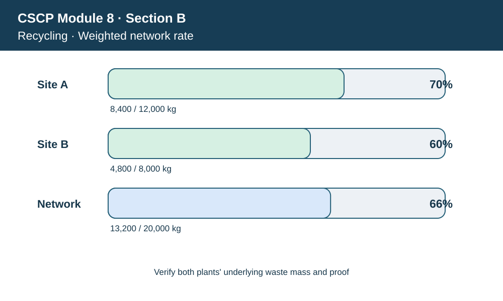
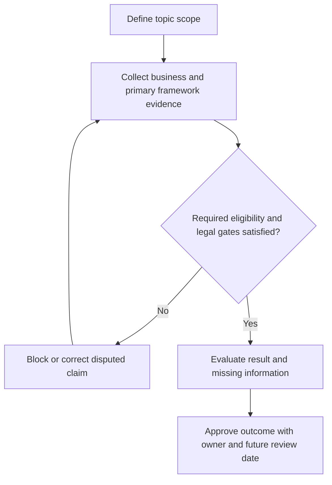

# 12. Sustainability KPIs, Reporting Boundaries, and Claim Integrity

## Learning objectives

Explain the current framework and decision scope for sustainability kpis, reporting boundaries, and claim integrity, distinguish source-edition terminology from official newer material, and apply verifiable evidence before making claims.

## Concept in plain English

A sustainability metric is useful only when its unit, population, time horizon, source and business meaning are clear. A favorable percentage can mislead if it excludes the less efficient factory or quietly changes the definition of recycled material. **Greenwashing** can arise from selective scope, unsupported product claims or presenting modeled reductions as verified real-world outcomes.

An auditable KPI starts from a defined impact and reporting boundary. Energy intensity requires energy and output over the same period. A waste diversion rate needs an eligible waste denominator and actual evidence of treatment. Emission totals require scope, activity records, emission-factor sources and consideration of estimation uncertainty. Worker safety indicators need consistent incident definitions and exposed populations. Raw record counts are not necessarily measures of performance; reported incidents can change when grievance access improves.

Reporting practices include a clear distinction between an organization's own operations, supplier activities, customer use and end-of-life recovery. Data aggregation should preserve site and partner identifiers. Where company reports use GRI, relevant disclosure editions and material topics are controlled separately from any statutory report. A public claim should not be approved by default merely because it appears in a well-designed dashboard.

Legal reporting obligations can change. The European Commission adopted revised European Sustainability Reporting Standards in 2026 after adjustments to the scope and reporting burden of the CSRD. This means a company's EU reporting requirement must be established for its legal entities and period, not inferred from a broad summary in a training book. The same principle applies to packaging, RoHS, WEEE, worker safety and other jurisdiction-dependent controls.

For AlderGate, a manager reports Site A's favorable recycling result as the network average. The compliance reviewer reconstructs the denominator for all included facilities, uncovers incomplete source support for Site B, and requires the draft public claim to be corrected. A meaningful disclosure should document the corrected result and the exceptions, not simply replace one attractive percentage with another.

**Learning source and edition checkpoint.** The CSCP source describes sustainability performance, implementation and reporting. More recent official EU and GRI publications require edition- and entity-specific reporting decisions; the 2026 EU ESRS update changed the reporting framework. AlderGate figures, workflows and assessments are independently constructed and illustrative, not content quoted from the APICS source.

## Why it matters

Stakeholders need figures they can verify and compare. The reporting process should catch distorted denominators and material missing evidence before marketing or executives use an environmental claim.

## Decision model and workflow

The topic-specific labels in the visual represent stages of the evidence and response process. A supply-chain manager should undertake these actions in order, preserving evidence of why an option could or could not proceed.

### Evidence retained through the workflow

| Evidence | Minimum control |
| --- | --- |
| Matched numerator/denominator and measurement period | Include source, owner, period and disposition |
| Site, supplier, emission-factor and disposal evidence | Include source, owner, period and disposition |
| Relevant standard edition, legal reporting scope and approval | Include source, owner, period and disposition |
| Exceptions, corrections and post-publication restatement rules | Include source, owner, period and disposition |

## Practical process flow

## Realistic example — AlderGate Motion Products

AlderGate is a fictional company with its own factories and suppliers. This scenario tests **sustainability kpis, reporting boundaries, and claim integrity** and requires the named decision makers to validate the standard and its business relevance. An attractive report does not replace a recorded review of implementation, scope and limitations. No actual supplier is identified or evaluated by this example.

## Applied decision artifact or worked calculation

[Download/view the directly linked fictional inputs](../../assets/data/module-8/section-b/recycling-lineage.csv)

Site A has **8,400/12,000 = 70%** verified recycling; Site B has **4,800/8,000 = 60%**. The **weighted network rate = (8,400+4,800)/(12,000+8,000) = 66%**. Reporting 70% for both sites overstates the aggregate. An unweighted average of 65% would use different weights from the physical kilogram denominator. Site B's two incomplete records also require reconciliation before the claim is finalized.

## Decision logic

- Define impacts, entities and the measurement boundary.
- Reconcile consistent units and primary source records.
- Assess gaps and legal disclosure requirements.
- Authorize only claims supported by the reviewed scope.

## Trade-offs

| Topic-specific concern | Consequence |
| --- | --- |
| Rapid publication | Can amplify incorrect assumptions |
| Broader boundary | Increases relevance but demands more supplier evidence |
| High-level dashboard | Useful overview but can hide site-level uncertainty |

## Commonly confused with

Sustainability KPIs, Reporting Boundaries, and Claim Integrity establishes particular guidance, control or reporting meaning; it does not mean any reported percentage is an official sustainability score. **Accreditation**, **certification**, **voluntary alignment**, and **legal approval** are different terms, with distinct evidence requirements. Review their scope and edition before interpreting external claims.

## Common mistakes

- Reporting one site's result as the whole company's result.
- Averaging unlike percentages without appropriate weighting.
- Using superseded standards or unverifiable factors.

## Original knowledge check

**Question.** What is the verified weighted recycling rate for the two sites in the example?

A. 70%, matching the larger site

B. 65%, always average site rates equally

C. 60%, the less efficient site's rate

D. 66%, total verified recycled kilograms divided by total eligible kilograms

Answer and rationale

### Correct answer

**D. 66%, total verified recycled kilograms divided by total eligible kilograms**

### Why it is correct

The correct calculation is 13,200 divided by 20,000 kilograms, 66%.

### Why the other answers are wrong

- **A.** The larger site is not the full boundary.
- **B.** An unweighted average ignores differing waste mass.
- **C.** One site's performance is not the network value.

## Practitioner perspective

The supplier or operational evidence in ERP and connected applications needs validity dates, covered sites, current standard edition, data-source identifiers and exception owners. A reviewer must distinguish a verified operating practice from a submitted PDF or marketing promise. An unresolved control blocks the specific claim or activity where relevant, rather than being converted into a favorable default.

## Related concepts

- [Previous sustainability lesson](./11-iso-26000-sa8000-ansi-z10-and-assurance.md)
- [Module 7 risk governance](../../07-supply-chain-risk/README.md)
- [Module 8 overall path](../README.md)
- [Official primary reference 1](https://www.globalreporting.org/standards)
- [Official primary reference 2](https://finance.ec.europa.eu/news/commission-adopts-revised-sustainability-reporting-standards-2026-07-03_en)

---

[Section B overview](./README.md) · [Previous sustainability lesson](./11-iso-26000-sa8000-ansi-z10-and-assurance.md)
