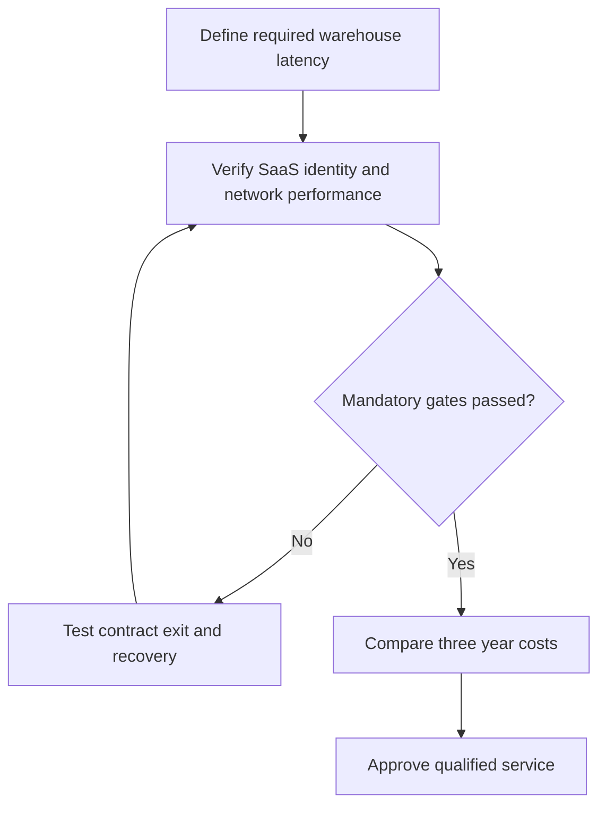

# 1. Cloud Service Models and Operating Trade-offs

## Learning objectives

Differentiate the relevant technologies, select business-fit evidence and define a feasible operating decision with accountable ownership.

## Concept in plain English

Cloud computing makes applications, capacity and data services accessible over networks instead of requiring all infrastructure to be permanently owned and hosted by the supply-chain organization. The CSCP source describes its flexible resource allocation, scaling and shared-service potential. **Software as a service (SaaS)** generally supplies a usable application; **platform as a service (PaaS)** supplies an environment for building and operating applications; **infrastructure as a service (IaaS)** supplies configurable computing and storage. These layers have different customer-versus-provider responsibilities.

AlderGate evaluates a cloud transportation application so qualified suppliers and carriers can view relevant events. Faster vendor onboarding and provider-managed upgrades may be attractive. Yet a monthly subscription is not free integration: identity management, access controls, master-data compatibility, support, monitoring and exit arrangements remain necessary. The source also warns about connectivity dependency, recurring payment, third-party custody of sensitive data and response-time requirements. Local machine-control systems can remain at the edge when their physical response threshold cannot safely depend on the public internet.

An application vendor may advertise automatic upgrades, but AlderGate still needs regression tests for interfaces, authorization and downstream processes. A contract ending or a connectivity outage must have a documented continuity and data-extraction plan. A network service that works in a sales demonstration may fail a heavily loaded warehouse or a partner whose event definitions differ from the original design.

The selection should therefore begin with a customer/service target, permitted data sharing and measurable latency/recovery conditions. Total cost compares equivalent horizons and includes implementation, subscription, staff, integration, cyber controls and change management. Module 2 retains detailed information architecture, while Section C owns emerging-technology selection and adoption.

**Source alignment:** CSCP Module 8 pp. 223–225; presentation slide 51. Course terms determine the scope; all AlderGate cases, decision graphics and calculations are independent examples.

## Why it matters

AlderGate's cloud choice affects partner response, operating costs and its ability to recover after connectivity loss. Cloud pricing is only one part of feasibility; the warehouse's physical response requirement and authorized access must be proved before comparing the three-year cost scenario.

## Decision model and workflow

### Evidence retained through the workflow

| Topic-specific evidence | Required check |
| --- | --- |
| Cloud service layer | Source, system boundary, accountable reviewer and disposition |
| Data and identity | Source, system boundary, accountable reviewer and disposition |
| Latency and recovery | Source, system boundary, accountable reviewer and disposition |
| Three-year economics | Source, system boundary, accountable reviewer and disposition |

## Practical process flow

## Realistic example — AlderGate Motion Products

AlderGate pilots a shared transport-event service with two third-party warehouses. It deliberately leaves safety-critical conveyor controls on site. The service is eligible only after IT tests role separation, record export, incident restoration and maximum delay from status capture to authorized planner response.

## Applied decision artifact or worked calculation

[Download the original fictional dataset](../../assets/data/module-8/section-c/cloud-comparison.csv)

Fictional SaaS recurring annual expense is **$123,000** ($96,000 subscription + $18,000 support + $9,000 connectivity) and one-time setup $36,000. The on-premises alternative is **$101,000 annually** plus $165,000 setup. Three-year **undiscounted** totals are **$405,000 SaaS** and **$468,000 on-premises**. This does not establish NPV or rank options before response-time and privacy gates.

## Decision logic

- Set a measurable event-delay and recovery limit.
- Confirm data permissions and vendor responsibilities.
- Stress test connectivity and safe local fallback.
- Reconcile subscription, integration and exit costs.

## Trade-offs

| Design question | Consideration |
| --- | --- |
| Fast deployment versus assurance | Integration and qualification may set a hard pace limit |
| Automatic decisions versus accountable review | A fast false conclusion can be more costly than a slow verified decision |
| New capabilities versus ongoing ownership | Future maintenance, vendor dependency and data governance must be funded |

## Commonly confused with

SaaS supplies application capabilities; PaaS supplies a managed development platform; IaaS exposes configurable infrastructure. These service models change the responsibility boundary, not the need for supply-chain data ownership. Cloud hosting alone is not business resilience.

## Common mistakes

- Assuming all physical controls should rely on public connectivity.
- Omitting SaaS contract exit and data extraction from the cost case.
- Accepting shared access without supplier and customer data segregation.

## Original knowledge check

**Question.** What should AlderGate verify before placing warehouse control events in a cloud application?

A. Only the vendor's brochure and first-month bill

B. Response time, permissions, recovery, data portability and business fit

C. That all plants can eliminate local control logic

D. That every supplier can view all customers' prices

Answer and rationale

### Correct answer

**B. Response time, permissions, recovery, data portability and business fit**

### Why it is correct

Feasibility includes latency, authorized access, continuity and exit evidence before cost ranking.

### Why the other answers are wrong

- **A.** A brochure cannot validate production operation.
- **C.** Physical controls may require local response even with cloud reports.
- **D.** Visibility must respect contractual and privacy access boundaries.

## Practitioner perspective

An ERP integration architect should preserve event IDs across carriers, test rate limits and retry logic, and document what keeps operating during a cloud outage. Export and restore acceptance belong in the vendor contract.

## Related concepts

- [Previous learning step](../README.md)
- [Module 2 digital supply-chain design](../../02-network-design-digital-connectivity-performance/README.md)
- [Module 7 continuity governance](../../07-supply-chain-risk/README.md)

---

[Section C overview](./README.md) · [Previous learning step](../README.md)
