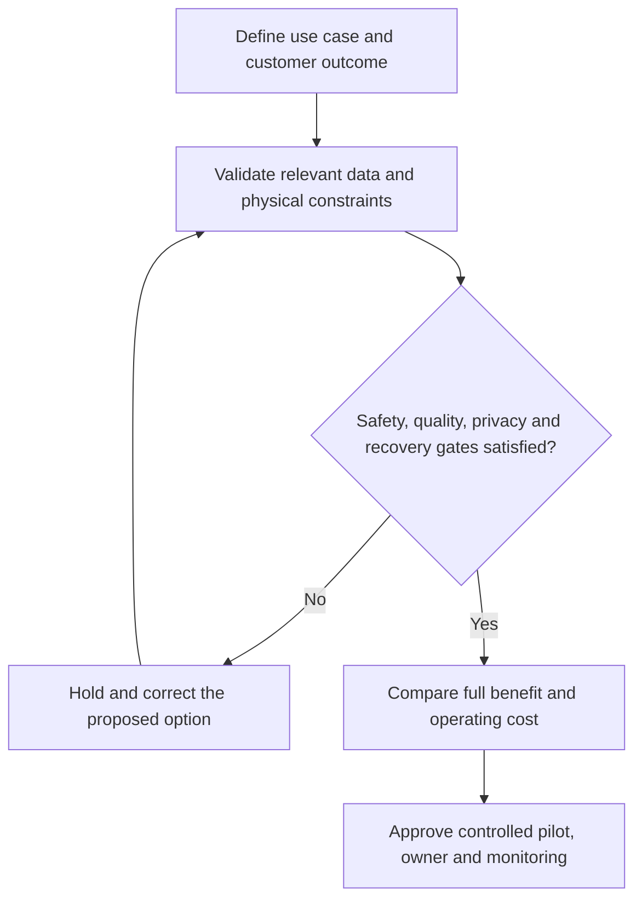

# 2. AI, Machine Learning, Expert Systems, and Data Analytics

## Learning objectives

Differentiate the relevant technologies, select business-fit evidence and define a feasible operating decision with accountable ownership.

## Concept in plain English

The CSCP learning source introduces artificial intelligence, machine learning, expert systems, heuristics and analytics as different mechanisms that can improve planning, exception response and pattern recognition. **Analytics** transforms data into information and decisions. **Machine learning** identifies relationships from data, whereas an **expert system** can use explicit domain rules. Mathematical optimization does not require an AI model, and a generative text system is not equivalent to a validated warehouse controller.

Predictive applications can flag abnormal machine condition, order-fraud patterns or at-risk shipments. A recommendation must still be judged against safety, commercial restrictions and decision rights. A model trained on historic normal operations may degrade when a new product launches or a supplier fails. Input lineage, labels, handling of missing data, testing on unseen periods, drift monitoring and fallback are essential, particularly when rare failures create severe losses.

Different metrics answer different questions. Accuracy can look strong in a data set where most assets never fail; recall indicates the fraction of actual failures detected, while precision tells operators how many issued alerts were true. The business needs the economic consequence of missed events and unnecessary investigation, not simply a high model score. Production use should retain overrides, version records and qualified escalation.

AI and analytics do not replace accountability. Data teams own technical performance, maintenance owns safe action, and management authorizes the scope of automation. A model's predictions are not physical facts. AlderGate must observe the actual change in machine downtime, emergency repairs and personnel workload compared with a credible baseline. Current AI governance frameworks can supplement the conceptual curriculum, but their version-specific requirements should be verified separately.

**Source alignment:** CSCP Module 8 pp. 225–227; slides 51–52. Course terms determine the scope; all AlderGate cases, decision graphics and calculations are independent examples.

## Why it matters

An algorithm can generate plausible forecasts or alerts while misunderstanding unusual operating conditions. Service owners should test detection quality and the cost of mistakes before permitting automatic production action.

## Decision model and workflow

### Evidence retained through the workflow

| Topic-specific evidence | Required check |
| --- | --- |
| Training evidence | Source, system boundary, accountable reviewer and disposition |
| False alerts | Source, system boundary, accountable reviewer and disposition |
| Missed failures | Source, system boundary, accountable reviewer and disposition |
| Authorized intervention | Source, system boundary, accountable reviewer and disposition |

## Practical process flow

## Realistic example — AlderGate Motion Products

AlderGate evaluates condition alerts for repair presses. Maintenance reviews each proposed intervention, including whether a machine can safely continue, while the analytics team monitors false positives, missed failures and changes in input signals.

## Applied decision artifact or worked calculation

[Download the original fictional dataset](../../assets/data/module-8/section-c/ai-failure-detection.csv)

The training pilot detects **18 of 20** actual machine failures (**90% recall**). It issues 48 alerts, of which 18 are true (**37.5% precision**). Classification accuracy is (18 + 150)/200 = **84%**. These three ratios express different realities and cannot establish downtime savings without comparing actions, safety and costs.

## Decision logic

- Name the customer or plant outcome and its measurement period.
- Determine which observations or qualified input records enable the proposed technology.
- Preserve legal, safety, security and technical feasibility as separate approval gates.
- Compare eligible alternatives over a common horizon including ongoing costs and limits.
- Review actual outcomes against the baseline and retain independent acceptance evidence.

## Trade-offs

| Design question | Consideration |
| --- | --- |
| Fast deployment versus assurance | Integration and qualification may set a hard pace limit |
| Automatic decisions versus accountable review | A fast false conclusion can be more costly than a slow verified decision |
| New capabilities versus ongoing ownership | Future maintenance, vendor dependency and data governance must be funded |

## Commonly confused with

A technical demonstration is not a completed business case. A model prediction, verified physical measurement and permitted business action are different evidence types. No vendor claim replaces the specified operating test.

## Common mistakes

- Selecting technology by name before defining the constrained process.
- Assuming missing evidence implies a successful physical result.
- Ignoring integration, support, recovery or upgrade costs.
- Overriding mandatory qualifications using a weighted savings score.

## Original knowledge check

**Question.** Which metric directly measures the proportion of actual failures detected by the pilot?

A. Annual AI software spending

B. Failure recall, with missed-event consequences

C. Number of dashboard screenshots

D. Total supplier count

Answer and rationale

### Correct answer

**B. Failure recall, with missed-event consequences**

### Why it is correct

Recall divides detected failures by all actual failures; the two missed failures still require a severity review.

### Why the other answers are wrong

- **A.** Software spending is not model detection.
- **C.** Dashboard count cannot measure model detection.
- **D.** Supplier count is not failure recall.

## Practitioner perspective

Enterprise applications must preserve identity, event timing, permitted actions and error recovery. A solution architect should be able to explain where a pilot can fail safely and who is authorized to restart it.

## Related concepts

- [Previous learning step](./01-cloud-service-models-and-operating-tradeoffs.md)
- [Module 2 digital supply-chain design](../../02-network-design-digital-connectivity-performance/README.md)
- [Module 7 continuity governance](../../07-supply-chain-risk/README.md)

---

[Section C overview](./README.md) · [Previous learning step](./01-cloud-service-models-and-operating-tradeoffs.md)
