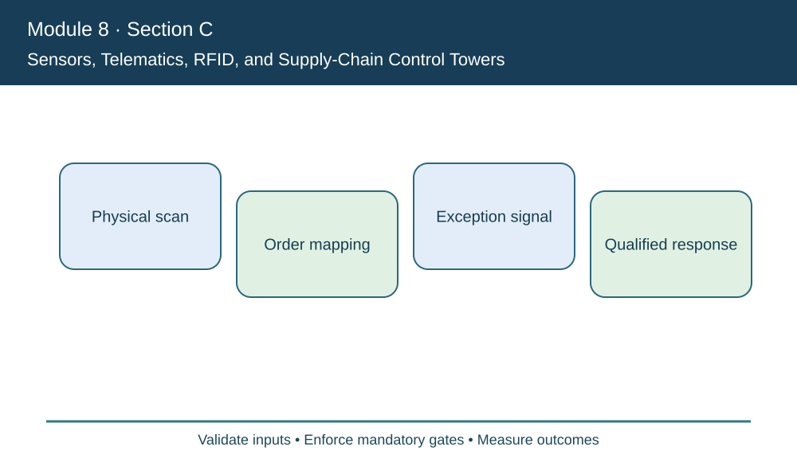
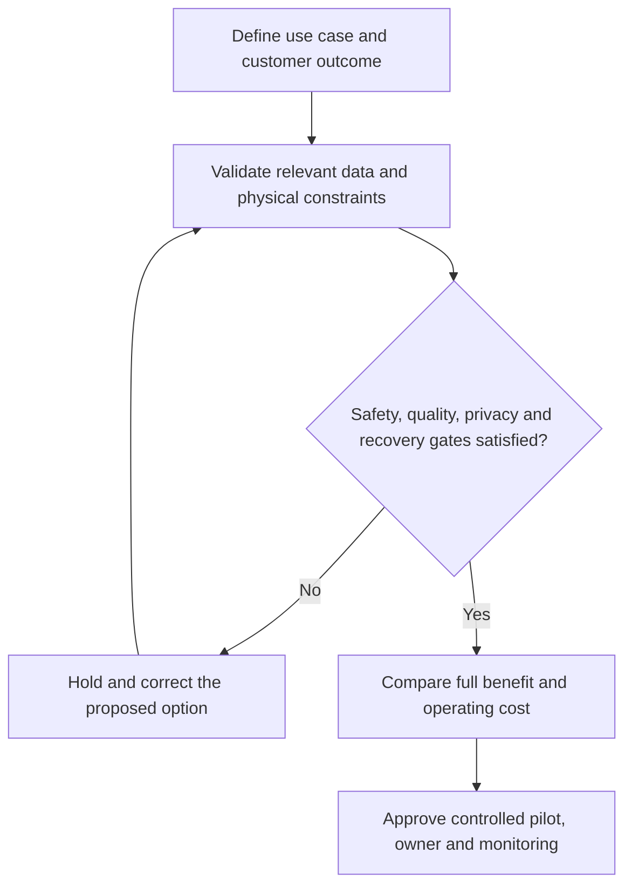

# 3. Sensors, Telematics, RFID, and Supply-Chain Control Towers

## Learning objectives

Differentiate the relevant technologies, select business-fit evidence and define a feasible operating decision with accountable ownership.

## Concept in plain English

Sensors translate physical events into data. Telematics shares information about mobile assets; RFID and optical codes support automated identification. A **supply-chain control tower** consolidates events from multiple organizations to detect exceptions and coordinate an authorized response. These are complementary capabilities rather than interchangeable technology products.

A temperature sensor can report a warm trailer, but the organization must know which product lots are present, whether the reading is valid, which customer orders are affected and who may decide disposition. More sensors without reliable identity can create greater confusion. Different carriers may use inconsistent event statuses, timestamps or order keys. Shared semantics, reconciliation and event lineage are therefore central to a trustworthy tower.

Visibility and control also differ. A system can display a predicted delayed shipment yet lack authority to reserve substitute inventory, change a commitment or release alternate transport. The source distinguishes monitoring from technologies that support exception management and optimization. The operation needs mapped escalation rights and hard gates carried forward from Module 7 so that a faster automated suggestion does not compromise quality or customer priority.

Physical readings can fail: an RFID scan may be duplicated, a device can lose power, and telematics messages may arrive out of order. Missing events should be reported as missing, not silently interpreted as lost inventory. Event replay, timestamps and anomaly triage should be tested with warehouse and transportation partners.

AlderGate tests an order-level event feed against a manually maintained carrier log. The relevant outcome is reliable matching and owned response within the customer promise, not the raw number of instrumented pallets or dashboards.

**Source alignment:** CSCP Module 8 pp. 227–230; slides 51–53. Course terms determine the scope; all AlderGate cases, decision graphics and calculations are independent examples.

## Why it matters

Cross-partner visibility creates value only when an accurate event reaches someone authorized to act. Timestamp quality, order identity and escalation logic matter more than a colorful global map.

## Decision model and workflow

### Evidence retained through the workflow

| Topic-specific evidence | Required check |
| --- | --- |
| Physical scan | Source, system boundary, accountable reviewer and disposition |
| Order mapping | Source, system boundary, accountable reviewer and disposition |
| Exception signal | Source, system boundary, accountable reviewer and disposition |
| Qualified response | Source, system boundary, accountable reviewer and disposition |

## Practical process flow

## Realistic example — AlderGate Motion Products

A carrier's trailer telematics indicates a two-day delay. AlderGate's control tower links the trailer to approved customer orders, checks available qualified substitutes and sends the exception to the appropriate planner. It cannot release restricted stock without required Quality approval.

## Applied decision artifact or worked calculation

[Download the original fictional dataset](../../assets/data/module-8/section-c/tower-event-pilot.csv)

Order linkage improves from **140/200 = 70%** to **188/200 = 94%** in the fictional pilot. Events actioned within the stated target rise from **90/200 = 45%** to **164/200 = 82%**. The latter uses all received events as its denominator; neither rate proves better revenue without a separate outcome check.

## Decision logic

- Name the customer or plant outcome and its measurement period.
- Determine which observations or qualified input records enable the proposed technology.
- Preserve legal, safety, security and technical feasibility as separate approval gates.
- Compare eligible alternatives over a common horizon including ongoing costs and limits.
- Review actual outcomes against the baseline and retain independent acceptance evidence.

## Trade-offs

| Design question | Consideration |
| --- | --- |
| Fast deployment versus assurance | Integration and qualification may set a hard pace limit |
| Automatic decisions versus accountable review | A fast false conclusion can be more costly than a slow verified decision |
| New capabilities versus ongoing ownership | Future maintenance, vendor dependency and data governance must be funded |

## Commonly confused with

A technical demonstration is not a completed business case. A model prediction, verified physical measurement and permitted business action are different evidence types. No vendor claim replaces the specified operating test.

## Common mistakes

- Selecting technology by name before defining the constrained process.
- Assuming missing evidence implies a successful physical result.
- Ignoring integration, support, recovery or upgrade costs.
- Overriding mandatory qualifications using a weighted savings score.

## Original knowledge check

**Question.** What most clearly demonstrates business-useful visibility in the event pilot?

A. More dashboard panels regardless of event validity

B. More GPS devices without order identifiers

C. Reliable order-linked events and actions within the defined target

D. A map image with no event timestamps

Answer and rationale

### Correct answer

**C. Reliable order-linked events and actions within the defined target**

### Why it is correct

Correct order linkage and timely authorized action are meaningful process measures.

### Why the other answers are wrong

- **A.** Display quantity does not indicate response effectiveness.
- **B.** Devices without business identity leave the customer impact uncertain.
- **D.** An unverified map image cannot demonstrate reliable operations.

## Practitioner perspective

Enterprise applications must preserve identity, event timing, permitted actions and error recovery. A solution architect should be able to explain where a pilot can fail safely and who is authorized to restart it.

## Related concepts

- [Previous learning step](./02-ai-machine-learning-and-data-analytics.md)
- [Module 2 digital supply-chain design](../../02-network-design-digital-connectivity-performance/README.md)
- [Module 7 continuity governance](../../07-supply-chain-risk/README.md)

---

[Section C overview](./README.md) · [Previous learning step](./02-ai-machine-learning-and-data-analytics.md)
