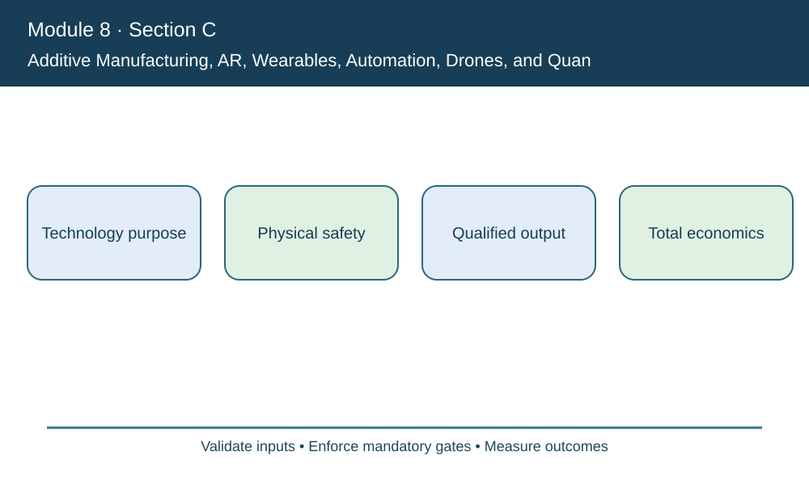
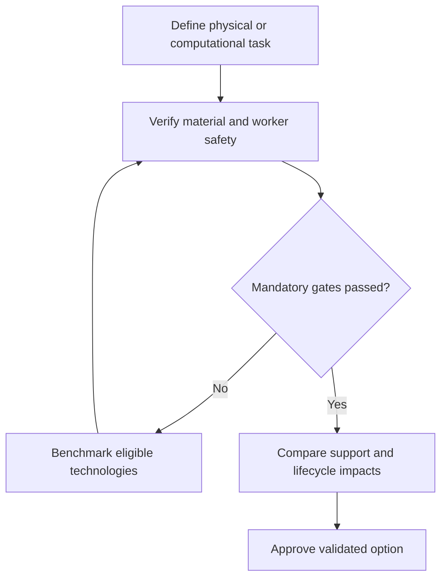

# 4. Additive Manufacturing, AR, Wearables, Automation, Drones, and Quantum

## Learning objectives

Differentiate the relevant technologies, select business-fit evidence and define a feasible operating decision with accountable ownership.

## Concept in plain English

Section C surveys several technologies with very different physical and computational roles. **Additive manufacturing (3D printing)** creates parts from digital models and may be useful for rapid prototypes or qualified spares. **Wearables and augmented reality** can guide hands-free warehouse work. **Robotic process automation (RPA)** automates structured digital tasks; mobile robots automate certain physical movements. **Drones** may support inspection or selected transport, while **quantum computing** is an emerging computing field with potential research applications to difficult optimization.

None of these labels alone establishes supply-chain value. Printing a replacement part locally might save freight but fail the product's strength, traceability or certification requirements. An AR headset may shorten instructions but distract an operator near moving equipment. Robotic movement can reduce walking yet require collision protection, charging, fleet coordination and emergency fallback. RPA can accelerate an error if the underlying workflow is poorly controlled.

The course describes quantum computing as a developing field of potential interest for combinatorial optimization. It should not be presented as a current guaranteed replacement for tested classical solvers. Before ranking methods, analysts must compare solution quality under identical constraints, computation time, operating reliability and complete costs. A promising demonstration on a specially selected case is not a production benchmark.

AlderGate chooses among qualified supplier expedites, approved buffer stock and local additive manufacturing for a critical repair. The fastest additive candidate has not passed metallurgical testing and is ineligible. The organization then evaluates the eligible choices on matched customer service and financial horizons, rather than weighting away the failed physical constraint.

**Source alignment:** CSCP Module 8 pp. 230–235; slides 51–52. Course terms determine the scope; all AlderGate cases, decision graphics and calculations are independent examples.

## Why it matters

Emerging devices and algorithms solve fundamentally different bottlenecks. AlderGate cannot compare a printed spare part, AR training, robotics and route computation from their technology labels; qualification and actual customer service define feasibility.

## Decision model and workflow

### Evidence retained through the workflow

| Topic-specific evidence | Required check |
| --- | --- |
| Technology purpose | Source, system boundary, accountable reviewer and disposition |
| Physical safety | Source, system boundary, accountable reviewer and disposition |
| Qualified output | Source, system boundary, accountable reviewer and disposition |
| Total economics | Source, system boundary, accountable reviewer and disposition |

## Practical process flow

## Realistic example — AlderGate Motion Products

Engineering demonstrates a two-day printed part, but Quality finds its testing incomplete. Procurement compares a four-day qualified supplier response against three-day protected finished stock. Both require sourcing, working-capital and obsolescence review.

## Applied decision artifact or worked calculation

[Download the original fictional dataset](../../assets/data/module-8/section-c/emerging-options.csv)

The two-day additive candidate is **not feasible** without material qualification. The eligible buffer alternative models **three-day response** and **$59,000 recurring annual cost**, versus four days and $68,000 for the qualified supplier. This limited scenario excludes obsolescence, service penalties and terminal value; the setup and decision horizon must still be compared.

## Decision logic

- For printed parts require mechanical and traceability qualification.
- For robots and wearables test interaction with workers.
- Benchmark quantum claims against classical feasible solutions.
- Fund maintenance and safe fallback before deployment.

## Trade-offs

| Design question | Consideration |
| --- | --- |
| Fast deployment versus assurance | Integration and qualification may set a hard pace limit |
| Automatic decisions versus accountable review | A fast false conclusion can be more costly than a slow verified decision |
| New capabilities versus ongoing ownership | Future maintenance, vendor dependency and data governance must be funded |

## Commonly confused with

Additive manufacturing creates physical objects, while RPA automates structured digital steps. AR overlays work instructions; AGVs and mobile robots move material. Quantum computing remains a specialized developing field and is not guaranteed to outperform a conventional solver.

## Common mistakes

- Selecting an unqualified printed part because lead time is shorter.
- Treating a robot demonstration as a plant safety approval.
- Assuming every optimization problem benefits from quantum processing.

## Original knowledge check

**Question.** Which conclusion follows from a two-day printed repair part that lacks a required material qualification?

A. Use it because the lead time is shortest

B. Assume local printing establishes lower lifecycle emissions

C. Hold it as infeasible and evaluate qualified alternatives

D. Ignore test criteria because quantum optimization is available

Answer and rationale

### Correct answer

**C. Hold it as infeasible and evaluate qualified alternatives**

### Why it is correct

Safety and technical suitability are hard eligibility gates prior to service or cost ranking.

### Why the other answers are wrong

- **A.** Urgency cannot waive material requirements.
- **B.** Lifecycle effects require independent evidence.
- **D.** A computational method cannot certify a physical part.

## Practitioner perspective

The technical owner should collect part test certificates, collision-stop evidence or algorithm benchmarks appropriate to the use case. Preserve what was excluded from each demonstration.

## Related concepts

- [Previous learning step](./03-sensors-telematics-and-control-towers.md)
- [Module 2 digital supply-chain design](../../02-network-design-digital-connectivity-performance/README.md)
- [Module 7 continuity governance](../../07-supply-chain-risk/README.md)

---

[Section C overview](./README.md) · [Previous learning step](./03-sensors-telematics-and-control-towers.md)
