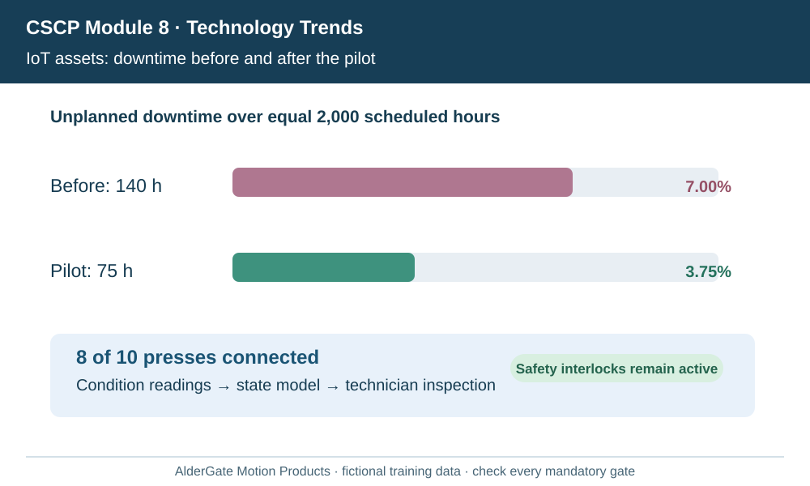
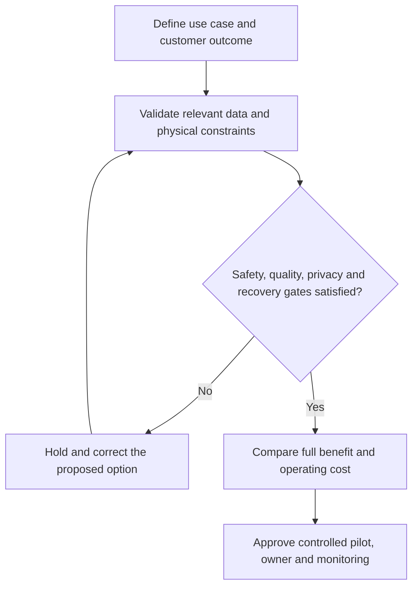

# 5. Intelligent Supply Chains: IoT, IAM, and Digital Twins

## Learning objectives

Differentiate the relevant technologies, select business-fit evidence and define a feasible operating decision with accountable ownership.

## Concept in plain English

An intelligent supply chain links physical state, trustworthy information, prediction and action to support customer and asset outcomes. The source highlights the **Internet of Things (IoT)**, **intelligent asset management (IAM)**, and related digital representations. IoT devices can send equipment, container or location measurements. IAM coordinates the condition, availability, maintenance and useful life of valuable assets. A **digital twin** represents a physical system with sufficiently relevant state updates to test or understand its operation.

These concepts should not be conflated. A connected sensor is only one input to an asset decision; it does not supply safe repair work orders or prove the equipment will fail. A static CAD drawing without meaningful operational synchronization may be a useful model but is not automatically a continuously updated twin. The fidelity of the model should match its decision: vibration and bearing temperature may matter for preventive maintenance, while customer-order allocation depends on inventory and route identity.

State coordination across firms needs clear ownership. A third-party maintenance provider may be permitted to read a machine's condition but not private customer pricing. Device faults, calibration drift and communications outages can generate inaccurate representations. The architecture must preserve last-update time, confidence and exception handling so a stale model does not silently direct an unsafe change.

The business case is improved asset availability, avoided emergency repairs and better resource use, not device count. Maintenance technicians need explicit authority to approve safety-sensitive inspections. AlderGate pilots connected production presses and a condition model; the team measures unplanned downtime while recording the workload and planned maintenance changes that could explain performance.

The curriculum's intelligent supply-chain theme integrates other technologies, but governance remains essential. Cryptographic custody records and analytics are only valuable when grounded in correct physical evidence and permitted business actions.

**Source alignment:** CSCP Module 8 pp. 235–240; slide 53. Course terms determine the scope; all AlderGate cases, decision graphics and calculations are independent examples.

## Why it matters

Connected assets can help identify problems sooner and coordinate repairs, yet a model is not a substitute for actual machine inspection and safe technical work.

## Decision model and workflow

### Evidence retained through the workflow

| Topic-specific evidence | Required check |
| --- | --- |
| IoT reading | Source, system boundary, accountable reviewer and disposition |
| Asset identity | Source, system boundary, accountable reviewer and disposition |
| Twin/condition model | Source, system boundary, accountable reviewer and disposition |
| Safe work action | Source, system boundary, accountable reviewer and disposition |

## Practical process flow

## Realistic example — AlderGate Motion Products

AlderGate connects eight of ten presses to a condition feed. A vibration anomaly creates a technician review request rather than an automatic override of machine safety interlocks. The maintenance lead records confirmed faults and actual lost-hours improvement.

## Applied decision artifact or worked calculation

[Download the original fictional dataset](../../assets/data/module-8/section-c/asset-condition.csv)

The fictional group experiences **140/2,000 = 7%** unplanned downtime before the pilot and **75/2,000 = 3.75%** during the pilot, a **3.25-percentage-point** decline. Eight of ten assets are connected (**80% coverage**). The association is not proof of causality unless workloads and other maintenance changes are reconciled.

## Decision logic

- Name the customer or plant outcome and its measurement period.
- Determine which observations or qualified input records enable the proposed technology.
- Preserve legal, safety, security and technical feasibility as separate approval gates.
- Compare eligible alternatives over a common horizon including ongoing costs and limits.
- Review actual outcomes against the baseline and retain independent acceptance evidence.

## Trade-offs

| Design question | Consideration |
| --- | --- |
| Fast deployment versus assurance | Integration and qualification may set a hard pace limit |
| Automatic decisions versus accountable review | A fast false conclusion can be more costly than a slow verified decision |
| New capabilities versus ongoing ownership | Future maintenance, vendor dependency and data governance must be funded |

## Commonly confused with

A technical demonstration is not a completed business case. A model prediction, verified physical measurement and permitted business action are different evidence types. No vendor claim replaces the specified operating test.

## Common mistakes

- Selecting technology by name before defining the constrained process.
- Assuming missing evidence implies a successful physical result.
- Ignoring integration, support, recovery or upgrade costs.
- Overriding mandatory qualifications using a weighted savings score.

## Original knowledge check

**Question.** What makes a digital twin different from an unchanging CAD drawing?

A. Any 3D visualization of equipment

B. The cost of the application's license

C. An arbitrary export of ERP tables

D. A meaningful relationship between physical-system updates and model-supported decisions

Answer and rationale

### Correct answer

**D. A meaningful relationship between physical-system updates and model-supported decisions**

### Why it is correct

A useful twin depends on operational state synchronization fit for a particular analysis or action.

### Why the other answers are wrong

- **A.** Visualization alone does not establish synchronization.
- **B.** Subscription cost is unrelated to model state.
- **C.** An unrelated export does not make an asset model current.

## Practitioner perspective

Enterprise applications must preserve identity, event timing, permitted actions and error recovery. A solution architect should be able to explain where a pilot can fail safely and who is authorized to restart it.

## Related concepts

- [Previous learning step](./04-additive-ar-wearables-robots-drones-quantum.md)
- [Module 2 digital supply-chain design](../../02-network-design-digital-connectivity-performance/README.md)
- [Module 7 continuity governance](../../07-supply-chain-risk/README.md)

---

[Section C overview](./README.md) · [Previous learning step](./04-additive-ar-wearables-robots-drones-quantum.md)
