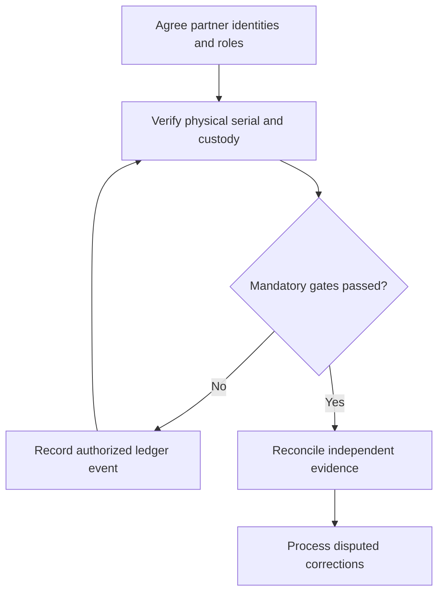

# 6. Blockchain, Provenance, and Smart-Contract Gates

## Learning objectives

Differentiate the relevant technologies, select business-fit evidence and define a feasible operating decision with accountable ownership.

## Concept in plain English

Blockchain is a distributed ledger approach that can link records using cryptographic methods and consensus rules. Supply chains may use a shared ledger for custody, provenance, inspection milestones or conditional transactions when multiple organizations need an auditable common history. It is one possible architecture, not a rule that every supply-chain system requires blockchain.

A recorded custody claim is only as accurate as the original input. If a worker scans the wrong serial number, the ledger can preserve an incorrect event with exceptional durability. A cryptographic hash does not qualify a product, inspect a shipment or verify that a real asset moved. Organizations still need reliable part identification, qualified scanning, role controls and reconciliation between physical and digital records.

**Smart contracts** can encode conditional business actions such as a payment being initiated after a verified receipt milestone. The definition of receipt must be legally and commercially valid, and the controlling event must come from an authorized source. Disputed quantity, damage or missing quality evidence cannot be ignored just because the ledger rule executes automatically. Error correction may require adding a new signed amendment rather than quietly overwriting the original record.

The source's shipbuilding case links QR/RFID identification, IoT observation and asset management with a phased ledger road map. Its important lesson is coordination of technologies and work practices rather than a mandate for a particular platform. AlderGate compares a permissioned ledger with a conventional audited shared database; the criterion is how effectively participating firms preserve trustworthy custody under common costs, performance and contract constraints.

Ledger governance must specify who may write, see, challenge and correct information and who funds operations after project closure. Module 7 owns broader fraud and continuity risk; Section C applies that risk gate to a technology architecture.

**Source alignment:** CSCP Module 8 pp. 237–243; slides 53–54. Course terms determine the scope; all AlderGate cases, decision graphics and calculations are independent examples.

## Why it matters

A shared ledger can make partner custody records tamper-evident, yet cannot establish that the original scan described the correct physical part. AlderGate's key control is physical-to-ledger evidence quality and enforceable dispute handling.

## Decision model and workflow

### Evidence retained through the workflow

| Topic-specific evidence | Required check |
| --- | --- |
| Permissioned participants | Source, system boundary, accountable reviewer and disposition |
| Scanned part | Source, system boundary, accountable reviewer and disposition |
| Verified custody | Source, system boundary, accountable reviewer and disposition |
| Dispute/correction | Source, system boundary, accountable reviewer and disposition |

## Practical process flow

## Realistic example — AlderGate Motion Products

AlderGate records certified component custody across four partners. Independent physical audits detect a few wrongly tagged events in an otherwise complete pilot ledger. The team retains corrections and decides whether partner governance justifies the infrastructure costs.

## Applied decision artifact or worked calculation

[Download the original fictional dataset](../../assets/data/module-8/section-c/custody-events.csv)

In the fictional custody trial, recorded completeness improves from **92/100 = 92%** to **99/100 = 99%**. Independent physical validation confirms **96/100 = 96%** of expected custody events in the pilot. Record completeness and verified physical correctness are different metrics; neither is a declaration that all parts are safe.

## Decision logic

- Define who can append or inspect each custody record.
- Verify part and lot identity before signing events.
- Use corrections that retain original history and dispute context.
- Compare ledger and conventional database governance costs.

## Trade-offs

| Design question | Consideration |
| --- | --- |
| Fast deployment versus assurance | Integration and qualification may set a hard pace limit |
| Automatic decisions versus accountable review | A fast false conclusion can be more costly than a slow verified decision |
| New capabilities versus ongoing ownership | Future maintenance, vendor dependency and data governance must be funded |

## Commonly confused with

Cryptographic integrity protects recorded information under system rules; physical truth requires separate inspection. A smart contract automates specified conditions but does not resolve damaged-goods disputes by itself. A shared database may be sufficient without distributed consensus.

## Common mistakes

- Equating an immutable record with a valid quality certificate.
- Automatically releasing disputed payments from ambiguous events.
- Ignoring the cost and governance of distributed participants.

## Original knowledge check

**Question.** What remains necessary after a shipment custody record is secured on an immutable ledger?

A. Verification that the physical event and part identity were correct

B. Assuming the hash is a physical quality inspection

C. Removing responsibilities from logistics partners

D. Eliminating the need for legal and customer conditions

Answer and rationale

### Correct answer

**A. Verification that the physical event and part identity were correct**

### Why it is correct

Cryptographic record integrity cannot establish the truth of an originally incorrect physical scan.

### Why the other answers are wrong

- **B.** Hashing is not product qualification.
- **C.** Business participants retain accountability.
- **D.** Technology does not waive contractual obligations.

## Practitioner perspective

Business integration should link the permitted writer, physical custody check, serialized item and reversal or correction event. Payment-trigger conditions require Quality and contract ownership.

## Related concepts

- [Previous learning step](./05-intelligent-iot-asset-management-digital-twins.md)
- [Module 2 digital supply-chain design](../../02-network-design-digital-connectivity-performance/README.md)
- [Module 7 continuity governance](../../07-supply-chain-risk/README.md)

---

[Section C overview](./README.md) · [Previous learning step](./05-intelligent-iot-asset-management-digital-twins.md)
