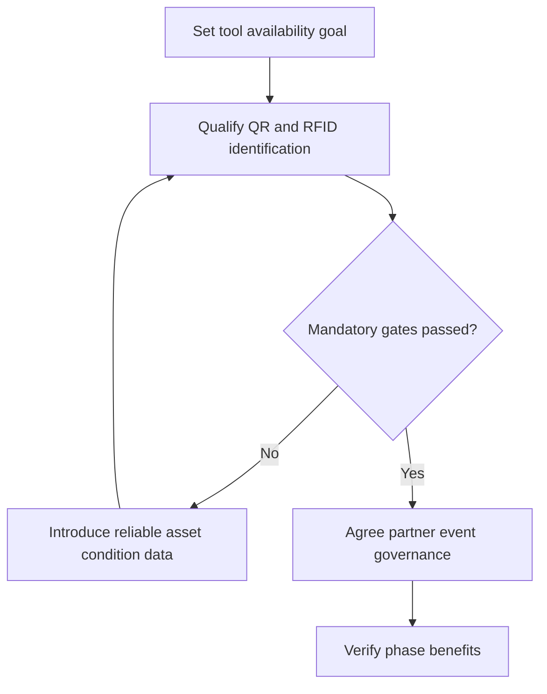

# 7. Technology Roadmaps and Phased Dependencies

## Learning objectives

Translate this topic into an actionable supply-chain project decision with evidence, realistic feasibility limits and an accountable business owner.

## Concept in plain English

A **technology roadmap** joins enterprise goals, data, capabilities, partner readiness, funding and timing. The manual uses a shipbuilder case involving asset-location visibility, QR and RFID identification, intelligent asset management, IoT condition information and a possible blockchain-based record. The important lesson is sequencing: an immutable record of an unverified asset number is not valuable just because it is securely stored.

A roadmap differs from a project schedule. It describes the direction and prerequisite capabilities across multiple initiatives; detailed delivery dates and work packages are managed by projects. An asset register should establish stable ownership and item identity before adding automated scanning. Partners need shared meanings for status events before integrating control towers or ledgers. A network of sensors cannot produce actionable maintenance decisions when the calibration and responsible owner are unknown.

Plans should cover short- and long-horizon outcomes. A phased rollout might improve tool search time before introducing condition-based maintenance; the next phase may deliver more accurate downtime estimates. Later shared provenance depends on all participating parties agreeing to a common custody vocabulary. Decision gates allow the organization to stop or redesign a phase that has not demonstrated prerequisites, rather than treating the published calendar as a command to deploy.

Leadership needs credible benefit attribution and financial scope. Savings from tool search and equipment availability must not be counted twice as independent improvements if they describe the same eliminated delay. The roadmap should also track the people and procedures required to operate each layer once the development team finishes.

AlderGate Motion Products develops a three-stage plan for tool and die tracking. During a pilot, metal interference reduces RFID scan quality, so the team retains QR identification for affected tools. The business does not equate an elegant future ledger architecture with a verified customer service benefit.

**Study-source mapping:** CSCP 2026 Module 8 pp. 239–243; slide 54. All worked examples and artifacts below are independent, fictional and scoped to stated inputs.

## Why it matters

AlderGate's phased asset program only delivers value when identity, sensing and partner governance mature in the correct order. The third-phase ledger benefit must remain a contingent scenario until participating organizations can exchange defined custody events.

## Decision model and workflow

### Evidence retained through the workflow

| Evidence domain | Required disposition |
| --- | --- |
| Strategic goal | Retain source, owner, threshold and review date |
| Asset IDs | Retain source, owner, threshold and review date |
| Partner dependency | Retain source, owner, threshold and review date |
| Validated benefit | Retain source, owner, threshold and review date |

## Practical process flow

## Realistic example — AlderGate Motion Products

AlderGate introduces verified identifiers and custody rules first, then condition monitoring, and only after partner governance considers a shared proof-of-custody ledger. The operations owner signs off each predecessor before later funding is released.

## Applied decision artifact or worked calculation

[Directly linked original training dataset](../../assets/data/module-8/section-c/technology-roadmap.csv)

Year-one asset identity improvement models **$18,000 annual savings** and qualified condition monitoring another **$46,000**. If the outcomes are independent and coexist, nominal modeled annual savings are **$64,000**. A third shared-ledger phase claiming $24,000 remains unapproved because partner event governance is incomplete.

## Decision logic

- Make verified asset master data a predecessor to scanning.
- Gate IoT adoption on calibration and maintenance ownership.
- Gate shared provenance on cross firm agreement.
- Release later funding only after measured phase acceptance.

## Trade-offs

| Management tension | Consequence |
| --- | --- |
| Early delivery versus complete requirements | Unresolved dependencies can create repeated rework |
| Enterprise standards versus justified customization | A unique extension must demonstrate ongoing value and supportability |
| Project completion versus sustained benefit | Go-live should be followed by measured operating results |

## Commonly confused with

A road map links business capabilities and dependencies over several horizons. A project schedule defines activities and dates for a particular deliverable. A technology wish list without named predecessors or benefit tests is neither.

## Common mistakes

- Purchasing shared-ledger infrastructure before partner data governance.
- Counting tentative phase-three benefits as realized revenue.
- Ignoring physical tag failure on metal equipment.

## Original knowledge check

**Question.** Why should asset identity and shared event definitions precede a multi-partner blockchain roll-out?

A. The manual mandates a fixed number of project years

B. Otherwise accurate cryptography may preserve inconsistent physical or business records

C. A blockchain automatically calibrates RFID readers

D. Partner agreement is irrelevant after procurement

Answer and rationale

### Correct answer

**B. Otherwise accurate cryptography may preserve inconsistent physical or business records**

### Why it is correct

A technology roadmap must protect the reliability of source information before preserving or sharing it.

### Why the other answers are wrong

- **A.** No universal timetable is mandatory.
- **C.** Ledger technology does not validate physical observations.
- **D.** Intercompany data semantics and authority remain essential.

## Practitioner perspective

The architecture road map should identify controlled master data, physical tagging tests and independent partner sign-offs as predecessors. Treat benefit attribution as a financial evidence task.

## Related concepts

- [Previous topic](./06-blockchain-provenance-and-smart-contract-gates.md)
- [Module 2 network and digital design](../../02-network-design-digital-connectivity-performance/README.md)
- [Module 7 contingency gates](../../07-supply-chain-risk/README.md)

---

[Section C overview](./README.md) · [Previous topic](./06-blockchain-provenance-and-smart-contract-gates.md)
