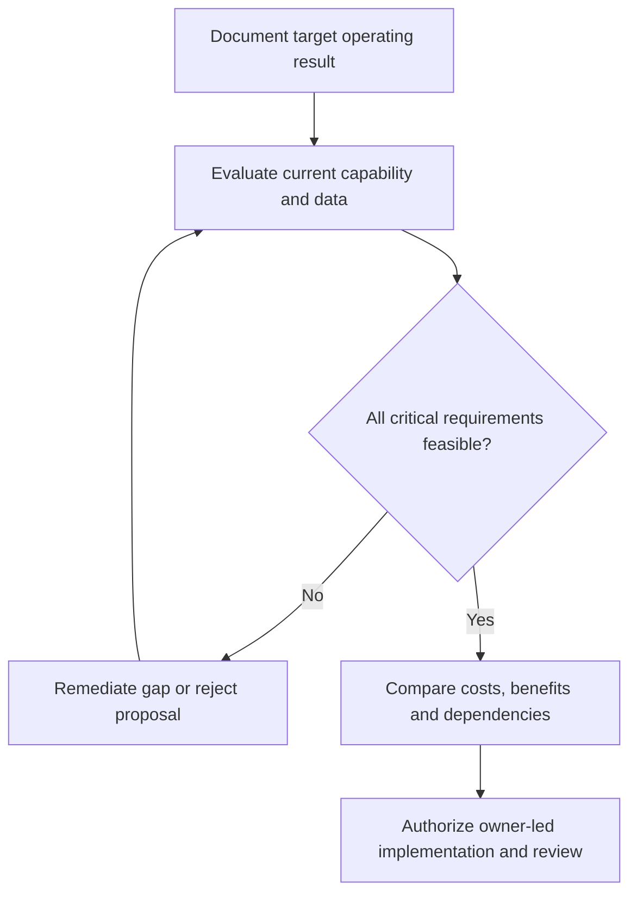

# 8. Technology Audits, Due Diligence, and Post-Implementation Reviews

## Learning objectives

Translate this topic into an actionable supply-chain project decision with evidence, realistic feasibility limits and an accountable business owner.

## Concept in plain English

A **technology audit** tests whether a system and its surrounding processes support the intended business control and value. The manual describes internal and external technology audits, technology selection due diligence, IT risks, lessons learned and post-implementation reviews. A system may deliver every contracted feature but still fail a customer promise through weak data, poor adoption or incompatible partner workflows.

The risk inventory should cover security, continuity, data accuracy, unmaintainable custom extensions, vendor capacity, insufficient operating skills and physical process constraints. Vendors can provide demonstrations and references, but those are not a substitute for scenarios and measurements from AlderGate's operations. The buying team should test claims against the integration boundary, business volumes, exception handling and operational recovery.

The course warns of costly customization when organizations preserve inefficient historical processes rather than adopting suitable process changes. Not every enhancement is inappropriate: a justified extension may provide a genuine competitive capability. But each should be assessed for its maintenance, update, testing and data consequences. The audit should distinguish technology gaps from process and organizational gaps so managers do not purchase software merely to hide weak operating ownership.

A post-implementation review should be included in the original charter. It compares realized performance and spending with approved expectations, records unanticipated incidents and examines whether intended benefits reached customers. Schedule and budget compliance are necessary project controls but not equivalent to business value. Lessons learned must have owners and follow-up rather than becoming another archived document.

AlderGate evaluates a visibility upgrade that passed factory acceptance testing but introduced duplicate order events in the production environment. Auditors assess interface mappings and reconcile physical fulfillment against digital confirmations. The order-release control remains blocked until the defect is independently resolved.

**Study-source mapping:** CSCP 2026 Module 8 pp. 244–249. All worked examples and artifacts below are independent, fictional and scoped to stated inputs.

## Why it matters

The decision changes AlderGate's ability to fulfill its intended customer promise, manage scarce resources and govern technology risks. Technical features matter only when the connected process can use them responsibly and support them after implementation.

## Decision model and workflow

### Evidence retained through the workflow

| Evidence domain | Required disposition |
| --- | --- |
| Audit scope | Retain source, owner, threshold and review date |
| Evidence | Retain source, owner, threshold and review date |
| Finding severity | Retain source, owner, threshold and review date |
| Benefit check | Retain source, owner, threshold and review date |

## Practical process flow

## Realistic example — AlderGate Motion Products

The internal audit finds 20 issues across interfaces, access and training, including a critical duplication defect. A steering committee records follow-up owners and does not equate the high rate of ordinary defect closure with legal and data-integrity readiness.

## Applied decision artifact or worked calculation

[Directly linked original training dataset](../../assets/data/module-8/section-c/technology-audit.csv)

The fictional audit has **20 total findings** and **15 verified closures**, a **75% closure rate**. One critical interface defect remains open. Therefore the affected automation cannot be released solely because most findings are closed.

## Decision logic

- Establish the business goal and evidence denominator before describing technical success.
- Confirm the relevant people, suppliers, physical resources and data controls are ready.
- Exclude proposals with unresolved mandatory quality, legal, security or safety failures.
- Compare the remaining alternatives on consistent cost and service horizons.
- Link release, ongoing support and reassessment to the responsible business owner.

## Trade-offs

| Management tension | Consequence |
| --- | --- |
| Early delivery versus complete requirements | Unresolved dependencies can create repeated rework |
| Enterprise standards versus justified customization | A unique extension must demonstrate ongoing value and supportability |
| Project completion versus sustained benefit | Go-live should be followed by measured operating results |

## Commonly confused with

A project schedule is not a technology roadmap, a vendor feature demonstration is not an accepted requirement, and an audit closure ratio is not an authority to bypass a critical defect. Each record has its own specific decision use.

## Common mistakes

- Treating a better numerical average as a substitute for mandatory eligibility.
- Buying an application before evaluating process, people or data causes.
- Omitting the owners and acceptance conditions for project benefits.
- Assuming a technology project ends when software is installed.

## Original knowledge check

**Question.** Which conclusion follows from 75% audit closure with one critical unresolved order-integrity defect?

A. Automated release is approved because most findings are closed

B. The remaining issue is always lower priority than user training

C. Affected release stays blocked until the critical integrity requirement is met

D. Technical log-in success proves the business case

Answer and rationale

### Correct answer

**C. Affected release stays blocked until the critical integrity requirement is met**

### Why it is correct

An explicit critical operational or compliance gate cannot be offset by aggregate closure percentage.

### Why the other answers are wrong

- **A.** Closure proportion says nothing about critical severity.
- **B.** Defect severity depends on the affected operation.
- **D.** Login tests cannot verify correct order release.

## Practitioner perspective

The solution team must preserve the relationship from requirement or finding to master data, processes, authorized user and acceptance test. Effective technology adoption requires post-go-live ownership.

## Related concepts

- [Previous topic](./07-technology-roadmaps-and-sequencing.md)
- [Module 2 network and digital design](../../02-network-design-digital-connectivity-performance/README.md)
- [Module 7 contingency gates](../../07-supply-chain-risk/README.md)

---

[Section C overview](./README.md) · [Previous topic](./07-technology-roadmaps-and-sequencing.md)
