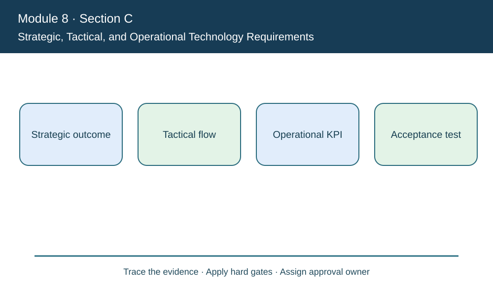
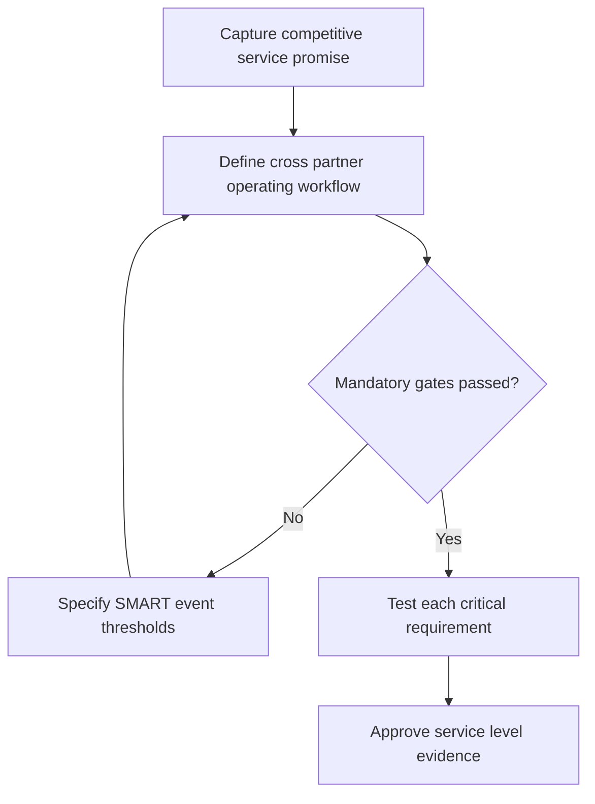

# 9. Strategic, Tactical, and Operational Technology Requirements

## Learning objectives

Translate this topic into an actionable supply-chain project decision with evidence, realistic feasibility limits and an accountable business owner.

## Concept in plain English

Technology needs should be expressed at several levels. **Strategic requirements** express how a system supports competitive positioning, structural integration and long-term decision capability. **Tactical requirements** define usable processes, automation and flexibility needed to operate the strategy. **Operational requirements** state the specific observable behavior, accuracy, timeliness, capacity and controls needed in real workflows.

For example, AlderGate's strategy may promise rapid visibility of engineered repair status. The tactical solution could offer role-based exception management across a supplier and two warehouses. A testable operational requirement might demand that 95% of relevant order-event changes become visible to authorized planners within ten minutes. The business must define who counts as a relevant order, what starts and stops the timer and how missing events are handled.

The manual encourages **SMART** objectives: specific, measurable, attainable, relevant and time-bound. A slogan such as "make planning digital" is not a specification or reliable vendor selection criterion. Every requirement should have a source owner, acceptance test, integration dependency and business rationale. Quality and cyber controls should not be hidden in a vendor presentation's performance score.

Tactical usefulness also depends on people and processes. A plant may gain sophisticated automated calculations yet need planners who can interpret exceptions and partner owners who can validate master data. A useful requirements workshop includes sales, sourcing, IT, Quality, logistics and finance where relevant. This prevents one group's UI preference from overriding fundamental customer constraints.

AlderGate documents how its promise connects to process workflow and data acceptance. Two pilots may show different strengths; the selection can only be made fairly when both are tested against the same population, timing and authorized action.

**Study-source mapping:** CSCP 2026 Module 8 pp. 249–253. All worked examples and artifacts below are independent, fictional and scoped to stated inputs.

## Why it matters

AlderGate needs requirements linking a fast customer promise to feasible workflows and testable application behavior. Its supplier confirmation failure should not disappear behind a successful priority-order percentage.

## Decision model and workflow

### Evidence retained through the workflow

| Evidence domain | Required disposition |
| --- | --- |
| Strategic outcome | Retain source, owner, threshold and review date |
| Tactical flow | Retain source, owner, threshold and review date |
| Operational KPI | Retain source, owner, threshold and review date |
| Acceptance test | Retain source, owner, threshold and review date |

## Practical process flow

## Realistic example — AlderGate Motion Products

AlderGate translates 'real-time status' into measurable event age, access restrictions, and documented business ownership. The vendor must satisfy each critical acceptance threshold independently before a broader feature score is considered.

## Applied decision artifact or worked calculation

[Directly linked original training dataset](../../assets/data/module-8/section-c/requirement-results.csv)

Of **200** priority events, **192** appear within the defined target: **96%**, exceeding the fictional 95% requirement. Supplier confirmations pass only **82 of 100 = 82%**, missing a separate 90% requirement. The program must not declare all requirements met.

## Decision logic

- Use one denominator and timing boundary per requirement.
- Trace business priority to permitted system actions.
- Make partner confirmations independently testable.
- Require named acceptance owners rather than feature count.

## Trade-offs

| Management tension | Consequence |
| --- | --- |
| Early delivery versus complete requirements | Unresolved dependencies can create repeated rework |
| Enterprise standards versus justified customization | A unique extension must demonstrate ongoing value and supportability |
| Project completion versus sustained benefit | Go-live should be followed by measured operating results |

## Commonly confused with

A strategic objective describes competitive intent, a tactical requirement defines a process capability, and an operational requirement states observable behavior. SMART targets improve testability but do not waive security, quality or capacity constraints.

## Common mistakes

- Calling a vague digital ambition an acceptance condition.
- Hiding a failed supplier threshold in an overall average.
- Using a vendor feature brochure instead of business test scenarios.

## Original knowledge check

**Question.** Which is a properly testable operational technology requirement?

A. Become the most digital supplier

B. Buy the product with the most buttons

C. Provide modern user experiences whenever possible

D. Show verified priority exceptions to authorized planners within ten minutes for at least 95% of eligible events

Answer and rationale

### Correct answer

**D. Show verified priority exceptions to authorized planners within ten minutes for at least 95% of eligible events**

### Why it is correct

The requirement specifies a real event population, named behavior, time boundary and numeric acceptance criterion.

### Why the other answers are wrong

- **A.** The ambition lacks an acceptance test.
- **B.** Feature counts are not process requirements.
- **C.** An undefined experience promise cannot be objectively checked.

## Practitioner perspective

Maintain requirement-to-test traceability from commercial promise through order status field, partner event identity, timestamp and acceptance signer. Failures require owned remediation before rollout.

## Related concepts

- [Previous topic](./08-technology-audits-risk-and-post-implementation-review.md)
- [Module 2 network and digital design](../../02-network-design-digital-connectivity-performance/README.md)
- [Module 7 contingency gates](../../07-supply-chain-risk/README.md)

---

[Section C overview](./README.md) · [Previous topic](./08-technology-audits-risk-and-post-implementation-review.md)
