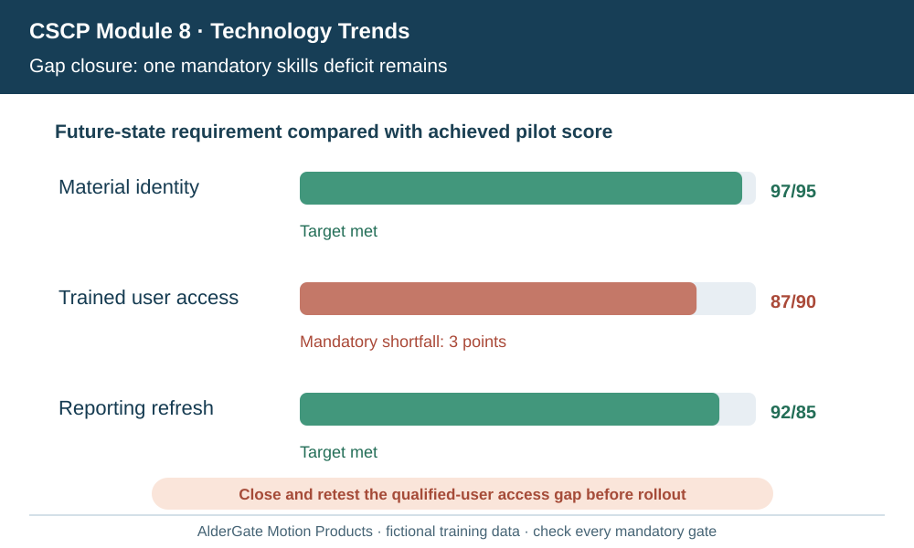
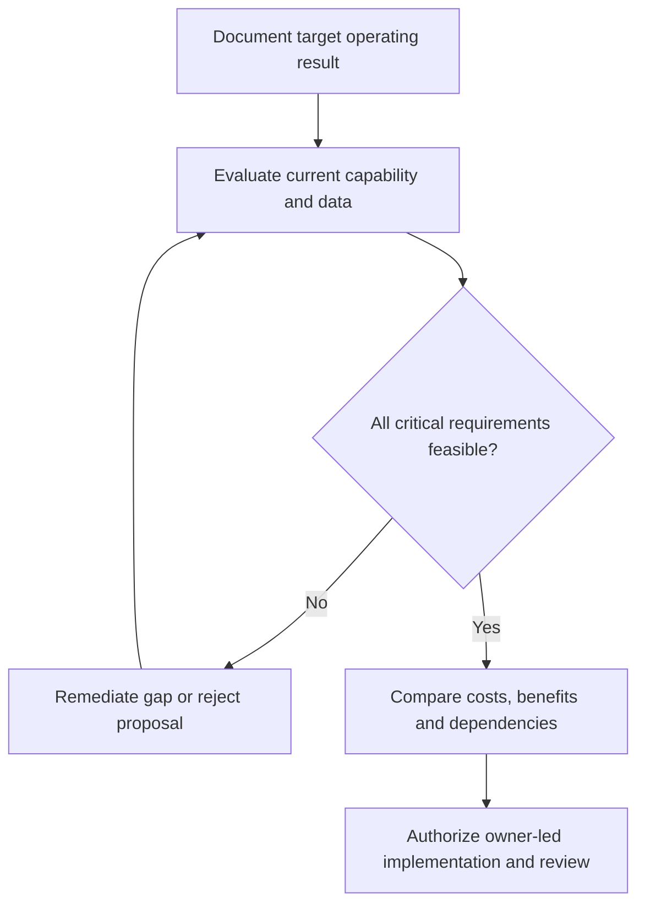

# 10. Technology Gap Analysis: Data, Process, People, and Architecture

## Learning objectives

Translate this topic into an actionable supply-chain project decision with evidence, realistic feasibility limits and an accountable business owner.

## Concept in plain English

A **gap analysis** compares existing capability with the future state required by an approved business strategy. The CSCP source considers process gaps, information and architecture gaps, technology deficiencies and human-resource skills. A costly new platform cannot solve an untrained staff, ungoverned master data or unclear decision authority problem by itself.

The current state should reflect real work, not only official procedures. Value-stream maps may reveal waiting time, rework or unwanted handoffs; architecture assessments show missing interfaces or inconsistent identifiers; workforce assessments expose training and management gaps. The future state should specify what the customer will experience and what operating evidence must exist to make that experience possible.

AlderGate's current order-visibility service may have reliable data delivery but poor partner part-number alignment. Replacing the application without correcting the shared reference data may recreate the original problem. A gap register should identify root cause, business consequence, closure action, resource estimate and accountable reviewer. Required data privacy and technician qualification must be treated as gates, not soft readiness preferences.

The assessment should distinguish quick fixes and foundational changes. Training dispatch workers may be practical within a small release, while redesigning supplier identifiers across legal entities could be a program-level dependency. Work should be sequenced to reduce rework and avoid claiming benefit from tools before users have the access and skills to act.

A gap may remain even when the average readiness score is high. A qualified emergency fulfillment process that requires trained user access cannot be deployed on the basis of unrelated successful reporting updates. The audit should record both the individual mandatory test and the overall roadmap effect.

**Study-source mapping:** CSCP 2026 Module 8 pp. 253–256. All worked examples and artifacts below are independent, fictional and scoped to stated inputs.

## Why it matters

The decision changes AlderGate's ability to fulfill its intended customer promise, manage scarce resources and govern technology risks. Technical features matter only when the connected process can use them responsibly and support them after implementation.

## Decision model and workflow

### Evidence retained through the workflow

| Evidence domain | Required disposition |
| --- | --- |
| Current state | Retain source, owner, threshold and review date |
| Required state | Retain source, owner, threshold and review date |
| Closure owner | Retain source, owner, threshold and review date |
| Retest result | Retain source, owner, threshold and review date |

## Practical process flow

## Realistic example — AlderGate Motion Products

At AlderGate, material identity and reporting refresh reach their pilot targets, but qualified user access remains incomplete. The team assigns identity mapping to master-data owners and access/training remediation to the plant lead, rather than repurchasing the analytics engine.

## Applied decision artifact or worked calculation

[Directly linked original training dataset](../../assets/data/module-8/section-c/technology-readiness-gaps.csv)

Pilot readiness reaches **97** against a material-identity target of **95**, and reporting refresh **92** against **85**. But trained-user access is **87** against a mandatory **90**. No average of the three figures can override the unresolved requirement.

## Decision logic

- Establish the business goal and evidence denominator before describing technical success.
- Confirm the relevant people, suppliers, physical resources and data controls are ready.
- Exclude proposals with unresolved mandatory quality, legal, security or safety failures.
- Compare the remaining alternatives on consistent cost and service horizons.
- Link release, ongoing support and reassessment to the responsible business owner.

## Trade-offs

| Management tension | Consequence |
| --- | --- |
| Early delivery versus complete requirements | Unresolved dependencies can create repeated rework |
| Enterprise standards versus justified customization | A unique extension must demonstrate ongoing value and supportability |
| Project completion versus sustained benefit | Go-live should be followed by measured operating results |

## Commonly confused with

A project schedule is not a technology roadmap, a vendor feature demonstration is not an accepted requirement, and an audit closure ratio is not an authority to bypass a critical defect. Each record has its own specific decision use.

## Common mistakes

- Treating a better numerical average as a substitute for mandatory eligibility.
- Buying an application before evaluating process, people or data causes.
- Omitting the owners and acceptance conditions for project benefits.
- Assuming a technology project ends when software is installed.

## Original knowledge check

**Question.** Two readiness requirements pass but mandatory trained-user access remains below its target. What next?

A. Deploy because average readiness improved

B. Close the user-access and skill gap before authorizing affected operation

C. Replace the forecasting software before investigating the cause

D. Lower the target without the owner's agreement

Answer and rationale

### Correct answer

**B. Close the user-access and skill gap before authorizing affected operation**

### Why it is correct

Mandatory workforce and access readiness requires independent satisfaction.

### Why the other answers are wrong

- **A.** An average cannot compensate for a failed hard gate.
- **C.** A system replacement may not resolve an access/skills gap.
- **D.** Controlled requirements cannot be rewritten solely to pass a test.

## Practitioner perspective

The solution team must preserve the relationship from requirement or finding to master data, processes, authorized user and acceptance test. Effective technology adoption requires post-go-live ownership.

## Related concepts

- [Previous topic](./09-strategic-tactical-operational-technology-requirements.md)
- [Module 2 network and digital design](../../02-network-design-digital-connectivity-performance/README.md)
- [Module 7 contingency gates](../../07-supply-chain-risk/README.md)

---

[Section C overview](./README.md) · [Previous topic](./09-strategic-tactical-operational-technology-requirements.md)
