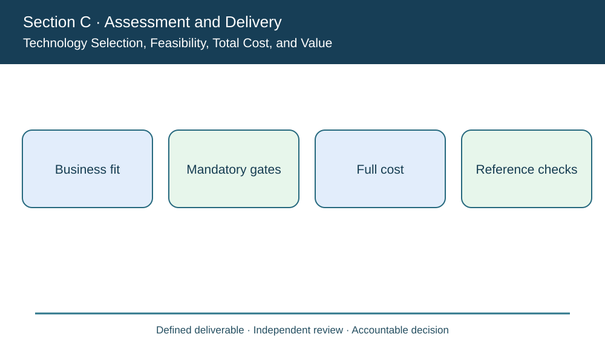
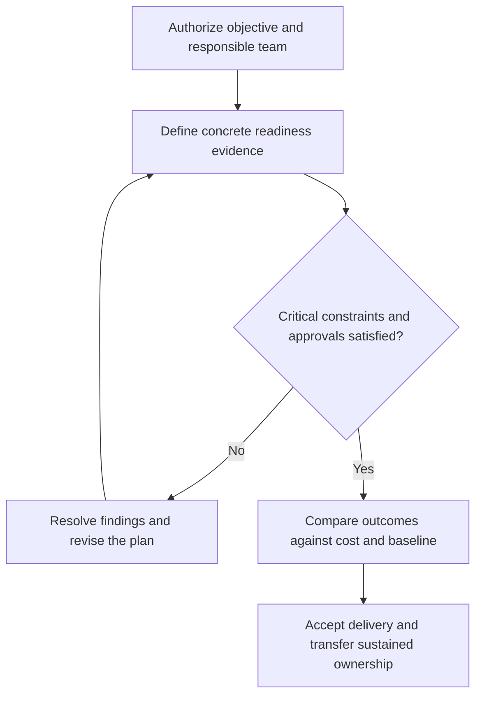

# 11. Technology Selection, Feasibility, Total Cost, and Value

## Learning objectives

Explain technology selection, feasibility, total cost, and value, decide how it applies to a real supply-chain initiative, and preserve a valid baseline, feasibility and ownership record.

## Concept in plain English

The CSCP source evaluates technology on competitive advantage, risk, feasibility, value, process fit and financial economics. The best proposal is not automatically the newest or the least expensive. An organization should first ask whether the system enables an important customer or capability outcome that existing processes cannot deliver acceptably.

**Total cost of ownership (TCO)** includes relevant licensing, hardware, infrastructure, integration, staff, service contracts, training, maintenance and exit expenses. A subscription can reduce early capital outlay while creating continuing cost and provider dependence. An internal build can provide differentiated control but requires long-term support skills and a delivery schedule. A vendor partnership may accelerate adoption yet create contractual and data-security responsibilities that remain with the buyer.

Hard feasibility must come before preference scoring. A vendor whose application exposes restricted supplier prices cannot win through attractive user-interface ratings. A production technology that exceeds allowed floor loading, has no certified operator or fails response-time limits likewise cannot be treated as eligible merely because its economic model looks good.

Among *eligible* options, a weighted score can make priorities explicit: quality, speed, dependability, flexibility, cost and implementation exposure. But weights should be agreed before vendor results are revealed. A sensitivity test checks whether a small assumption change reverses the preferred choice. Vendor due diligence includes reference checks, independent demonstrations, evidence of supportability and realistic integration conditions.

AlderGate Motion Products compares three visibility providers. The lowest priced appears to have the best weighted score but fails a mandatory data-access condition. The steering committee records that exclusion rather than lowering the security threshold to accommodate its preferred cost. Procurement then compares the eligible alternatives on confirmed service, fit and total operating cost.

**Study-source mapping:** CSCP Module 8 pp. 255–263. The illustrative project, calculations and assessments are independently authored examples.

## Why it matters

This topic determines whether a valuable supply-chain concept can be implemented without losing cost, quality, operational readiness or stakeholder accountability. Evidence must connect a chosen action to the enterprise's approved customer and operating outcomes.

## Decision model and workflow

### Evidence retained through the workflow

| Topic-specific record | Owner's verification |
| --- | --- |
| Business fit | State scope, period, acceptance and accountable reviewer |
| Mandatory gates | State scope, period, acceptance and accountable reviewer |
| Full cost | State scope, period, acceptance and accountable reviewer |
| Reference checks | State scope, period, acceptance and accountable reviewer |

## Practical process flow

## Realistic example — AlderGate Motion Products

AlderGate's purchase board evaluates proposals A, B and C on the same event volumes. Vendor C lacks role-level access protection; the board places its attractive score outside the feasible set and requests evidence of a corrected control before reconsideration.

## Applied decision artifact or worked calculation

[Original fictional working data](../../assets/data/module-8/section-c/technology-selection.csv)

Vendor C offers the lowest fictional recurring cost (**$65,000**) and top score (**94**) but fails a mandatory access gate. Of the eligible alternatives, B scores **86** against A's **78**, and its annual modeled cost is **$84,000** versus $92,000. The scores are not real vendor evaluations or substitute for contract and pilot evidence.

## Decision logic

- Validate the precise customer outcome and the authorized scope.
- Identify evidence owners, resource limits and implementation dependencies.
- Treat legal, safety, quality and data security as threshold conditions.
- Compare eligible choices and control changes to schedule, funding and deliverables.
- Preserve follow-up ownership and measurable benefits after handover.

## Trade-offs

| Trade-off | Decision boundary |
| --- | --- |
| Speed versus complete acceptance | Unqualified speed can move failure into production |
| Project scope versus business value | Features without a valid outcome should not consume resources |
| Formal planning versus adaptability | Approved changes can be accommodated while maintaining a baseline |

## Commonly confused with

A delivered technical component is not an accepted business outcome. A cost, scope or schedule report is valid only for its clearly defined baseline. Accountability differs from execution responsibility.

## Common mistakes

- Replacing acceptance evidence with a favorable aggregate percentage.
- Claiming that a project plan eliminates operational risk.
- Changing the scope informally and then reporting against the original baseline.
- Completing deployment without transferring support responsibilities.

## Original knowledge check

**Question.** How should AlderGate handle vendor C's high weighted score and failed security requirement?

A. Approve because its cost and score are superior

B. Average the security defect into a small penalty

C. Hold C ineligible until the mandatory access control is demonstrated

D. Ignore the privacy issue in a short pilot

Answer and rationale

### Correct answer

**C. Hold C ineligible until the mandatory access control is demonstrated**

### Why it is correct

Mandatory data protection is a threshold, not a weighted preference.

### Why the other answers are wrong

- **A.** High preference scores cannot override a legal/security gate.
- **B.** A penalty is not authorization to expose data.
- **D.** Even a pilot must meet its access obligations.

## Practitioner perspective

The enterprise delivery lead should connect charters, requirements, test results, project changes and operating handoff in one traceable record. The permanent process owner, not just the implementation team, must accept the ongoing responsibilities.

## Related concepts

- [Previous topic](./10-technology-gap-analysis-data-process-and-skills.md)
- [Module 7 supply risk governance](../../07-supply-chain-risk/README.md)
- [Section A financial choices](../section-a-optimizing-supply-chain-strategy-and-tactics/README.md)

---

[Section C overview](./README.md) · [Previous topic](./10-technology-gap-analysis-data-process-and-skills.md)
