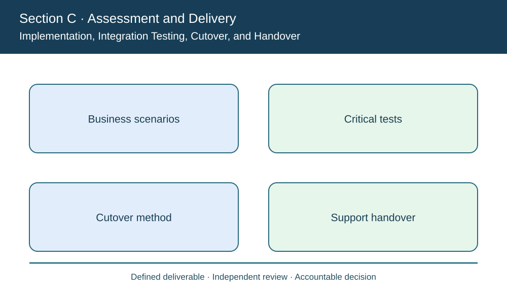
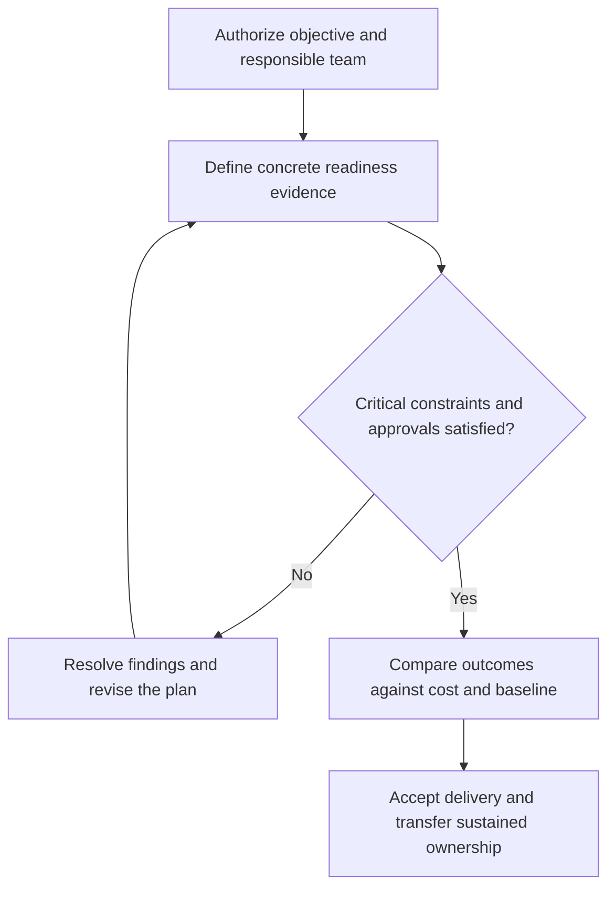

# 12. Implementation, Integration Testing, Cutover, and Handover

## Learning objectives

Explain implementation, integration testing, cutover, and handover, decide how it applies to a real supply-chain initiative, and preserve a valid baseline, feasibility and ownership record.

## Concept in plain English

Implementation is a controlled transition of work, information and decision rights into a new operating system. The manual stresses planning, technology testing, formal user training, transfer of deliverables to users, support and maintenance. Passing installation checks is not the same as validating the full order-to-delivery process.

A sensible test strategy distinguishes unit, integration, end-to-end, acceptance, negative and recovery scenarios. For example, an interface may handle a normal shipment confirmation but duplicate an order when the carrier retries after a network outage. An automated warehouse transaction may appear fast but be unsafe if the system cannot honor a Quality quarantine. Such cases must be tested with actual business owners and realistic volumes, not only developers.

**Cutover** determines how the organization switches from the old to the new operation. Direct cutover concentrates transition risk. A phased pilot limits exposure but may need temporary interfaces. **Parallel operation** can maintain a lower-risk comparison period while increasing expense and reconciliation work. The choice should reflect required recovery, business criticality, legal and quality controls, and the ability to return to a safe operating state.

Data conversion and user readiness are often as significant as software deployment. A newly installed warehouse application will underperform if master-data locations, serial records, order classifications or supplier event codes are incomplete. The support team must know who owns failures and where an exception can be recovered without double shipping.

AlderGate retains a legacy status-reconciliation view while its new order-visibility application is piloted. The team will retire the older process only after critical interfaces, recovery and qualified user support pass agreed tests. The company measures business benefits after go-live rather than declaring them achieved on the cutover date.

**Study-source mapping:** CSCP Module 8 pp. 263–266. The illustrative project, calculations and assessments are independently authored examples.

## Why it matters

This topic determines whether a valuable supply-chain concept can be implemented without losing cost, quality, operational readiness or stakeholder accountability. Evidence must connect a chosen action to the enterprise's approved customer and operating outcomes.

## Decision model and workflow

### Evidence retained through the workflow

| Topic-specific record | Owner's verification |
| --- | --- |
| Business scenarios | State scope, period, acceptance and accountable reviewer |
| Critical tests | State scope, period, acceptance and accountable reviewer |
| Cutover method | State scope, period, acceptance and accountable reviewer |
| Support handover | State scope, period, acceptance and accountable reviewer |

## Practical process flow

## Realistic example — AlderGate Motion Products

AlderGate tests its cutover across a real priority order path. Two of the outstanding tests permit restricted inventory to be offered; the business release is held while developers repair the conditions and QA retests them.

## Applied decision artifact or worked calculation

[Original fictional working data](../../assets/data/module-8/section-c/cutover-acceptance.csv)

The fictional suite passes **190 of 200 tests = 95%**, yet the two critical blocked-release tests fail. The 95% global pass rate cannot override a **zero-critical-failure** cutover requirement. Parallel support and rollback preparedness are separate approvals.

## Decision logic

- Validate the precise customer outcome and the authorized scope.
- Identify evidence owners, resource limits and implementation dependencies.
- Treat legal, safety, quality and data security as threshold conditions.
- Compare eligible choices and control changes to schedule, funding and deliverables.
- Preserve follow-up ownership and measurable benefits after handover.

## Trade-offs

| Trade-off | Decision boundary |
| --- | --- |
| Speed versus complete acceptance | Unqualified speed can move failure into production |
| Project scope versus business value | Features without a valid outcome should not consume resources |
| Formal planning versus adaptability | Approved changes can be accommodated while maintaining a baseline |

## Commonly confused with

A delivered technical component is not an accepted business outcome. A cost, scope or schedule report is valid only for its clearly defined baseline. Accountability differs from execution responsibility.

## Common mistakes

- Replacing acceptance evidence with a favorable aggregate percentage.
- Claiming that a project plan eliminates operational risk.
- Changing the scope informally and then reporting against the original baseline.
- Completing deployment without transferring support responsibilities.

## Original knowledge check

**Question.** AlderGate has a 95% test pass rate but two critical failures. What is the right release decision?

A. Deploy because 95% is high

B. Retire legacy controls during deployment

C. Assume the two failures will correct themselves

D. Block affected cutover until the critical conditions and recovery test pass

Answer and rationale

### Correct answer

**D. Block affected cutover until the critical conditions and recovery test pass**

### Why it is correct

A critical release-control test remains a hard gate regardless of aggregate percentage.

### Why the other answers are wrong

- **A.** A total score cannot replace a mandatory safety or integrity condition.
- **B.** Decommissioning safeguards early increases exposure.
- **C.** Uncorrected failures need action and independent retest.

## Practitioner perspective

The enterprise delivery lead should connect charters, requirements, test results, project changes and operating handoff in one traceable record. The permanent process owner, not just the implementation team, must accept the ongoing responsibilities.

## Related concepts

- [Previous topic](./11-technology-selection-feasibility-tco-and-value.md)
- [Module 7 supply risk governance](../../07-supply-chain-risk/README.md)
- [Section A financial choices](../section-a-optimizing-supply-chain-strategy-and-tactics/README.md)

---

[Section C overview](./README.md) · [Previous topic](./11-technology-selection-feasibility-tco-and-value.md)
