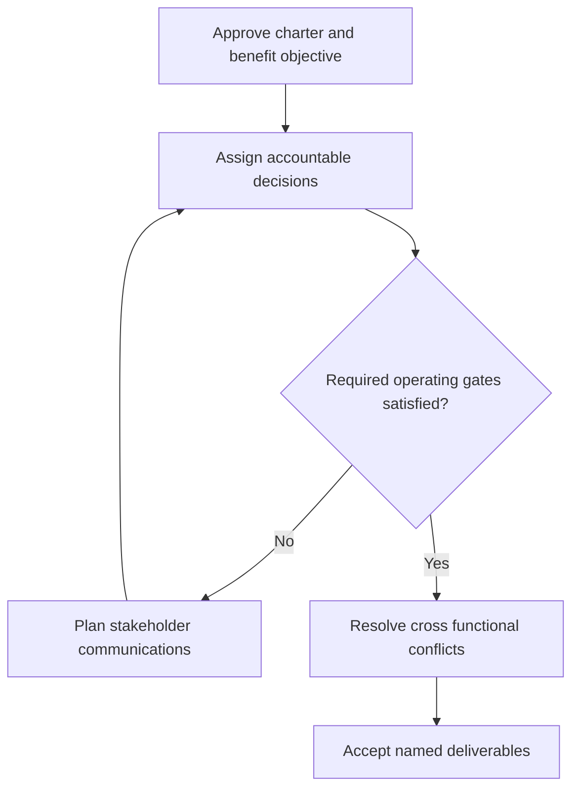

# 13. Project Charters, Stakeholder Communications, RACI, and Team Development

## Learning objectives

Explain project charters, stakeholder communications, raci, and team development, decide how it applies to a real supply-chain initiative, and preserve a valid baseline, feasibility and ownership record.

## Concept in plain English

A technology initiative that has a defined start and end and produces a distinct deliverable normally benefits from project governance, while routine support and recurring operational activity remain part of ongoing management. The CSCP source introduces formal **project charters**, sponsor authorization, project leadership, affected stakeholders, accountability, communication and team development.

A charter explains why the project exists, the expected outcome, broad scope, authority, funding and appointed manager. It should name the executive sponsor and the limits within which project leadership may commit resources. Without a charter, managers can assign staff to attractive work that lacks a valid business purpose or conflicts with larger priorities.

A responsibility assignment matrix such as **RACI** can clarify who is responsible for work, who is accountable for an outcome, who is consulted and who must be informed. Many people can perform work, but final accountability for a specific decision should not be diffused among several competing signers. The appropriate reviewer may change by deliverable: Finance approves funding assumptions, Quality releases qualification results and Operations accepts the business workflow. A matrix is useful only when the named people can actually exercise those authorities.

Team dynamics also matter. The source references the forming, storming, norming and performing progression: teams initially learn roles, may confront disagreements, build working rules and become more effective. A project manager should not treat reasonable conflict as purely unproductive; it can expose ambiguous requirements and unrealistic commitments before costly implementation.

AlderGate begins a warehouse event-standardization project with IT, suppliers, Quality and Logistics. The project charter establishes the business promise and reporting cadence. The integration lead implements data exchange, the operations sponsor accepts it and security retains veto authority over unlawful sharing. Clear communication keeps supplier onboarding and plant training aligned with a common release plan.

**Study-source mapping:** CSCP Module 8 pp. 266–272. The illustrative project, calculations and assessments are independently authored examples.

## Why it matters

Project delivery crosses departments with different responsibilities and approval authority. A clear charter, communication plan and RACI matrix help AlderGate avoid three conflicting 'final' go-live owners and support constructive team development.

## Decision model and workflow

### Evidence retained through the workflow

| Topic-specific record | Owner's verification |
| --- | --- |
| Charter | State scope, period, acceptance and accountable reviewer |
| Decision authority | State scope, period, acceptance and accountable reviewer |
| Stakeholder channels | State scope, period, acceptance and accountable reviewer |
| Team maturity | State scope, period, acceptance and accountable reviewer |

## Practical process flow

## Realistic example — AlderGate Motion Products

At AlderGate, several groups claim they own the 'go-live' decision. The charter resolves this by naming Operations as business acceptance owner, IT as technical implementer and Quality as the approval authority for quarantined material rules.

## Applied decision artifact or worked calculation

[Original fictional working data](../../assets/data/module-8/section-c/raci-handoffs.csv)

The fictional RACI matrix has **three deliverables** and exactly **one accountable owner for each**. That is a governance design rule used in this case, not a universal claim that a project should have only three roles. A project report that names three equal 'A' owners for a single approval would need clarification.

## Decision logic

- Name an empowered sponsor and project manager.
- Give each deliverable a single clear approval owner.
- Include partners and affected employees in communication.
- Revisit responsibilities as team capability matures.

## Trade-offs

| Trade-off | Decision boundary |
| --- | --- |
| Speed versus complete acceptance | Unqualified speed can move failure into production |
| Project scope versus business value | Features without a valid outcome should not consume resources |
| Formal planning versus adaptability | Approved changes can be accommodated while maintaining a baseline |

## Commonly confused with

A project sponsor authorizes the initiative, while the manager coordinates work. Responsible team members carry out tasks, but accountable owners accept the result. Tuckman's forming, storming, norming and performing model describes possible team evolution, not mandatory calendar dates.

## Common mistakes

- Starting unfunded technology work without a charter.
- Treating several conflicting final signers as clear accountability.
- Excluding suppliers who must adopt the new interface.

## Original knowledge check

**Question.** What is the main benefit of naming one accountable owner for each go-live deliverable?

A. It removes the need for technical specialists

B. It eliminates disagreements during project delivery

C. It clarifies final decision responsibility while other members still do and review work

D. It makes executive authorization unnecessary

Answer and rationale

### Correct answer

**C. It clarifies final decision responsibility while other members still do and review work**

### Why it is correct

RACI separates execution and consultation from who accepts the specified outcome.

### Why the other answers are wrong

- **A.** Work still needs subject matter specialists.
- **B.** Disagreements still require constructive resolution.
- **D.** The charter and sponsor remain essential.

## Practitioner perspective

Connect the approved charter to RACI decisions in the delivery tracker. The business acceptance owner, IT implementers, privacy officer and supplier contact each receive a documented communication role.

## Related concepts

- [Previous topic](./12-implementation-integration-testing-and-cutover.md)
- [Module 7 supply risk governance](../../07-supply-chain-risk/README.md)
- [Section A financial choices](../section-a-optimizing-supply-chain-strategy-and-tactics/README.md)

---

[Section C overview](./README.md) · [Previous topic](./12-implementation-integration-testing-and-cutover.md)
