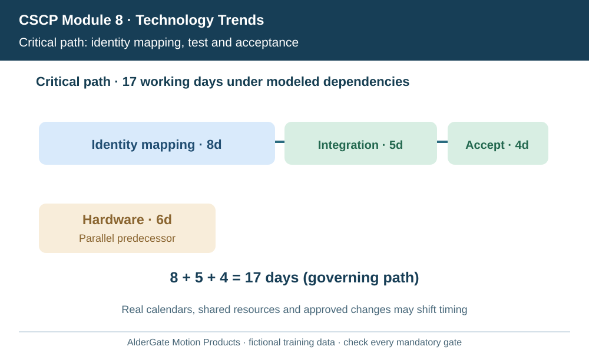
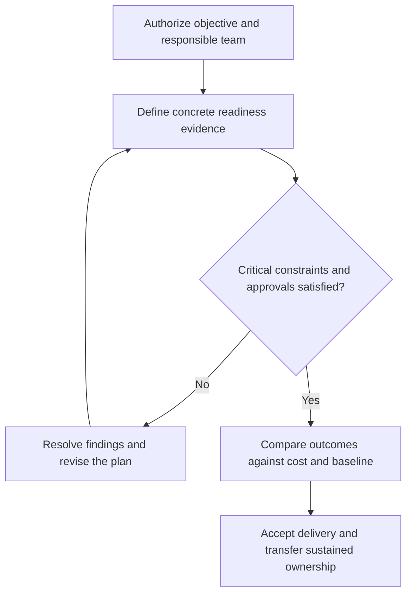

# 14. WBS, Schedule, Cost Baselines, and Project Change Control

## Learning objectives

Explain wbs, schedule, cost baselines, and project change control, decide how it applies to a real supply-chain initiative, and preserve a valid baseline, feasibility and ownership record.

## Concept in plain English

A project plan turns its authorized charter into defined scope, time, cost and resource baselines. The CSCP source introduces progressive elaboration, work breakdown structures, schedules, Gantt-chart views, budgeting, reserves and controlled baseline changes. The key distinction is that **a work breakdown structure (WBS)** organizes deliverables, whereas a project schedule connects the activities needed to produce them over time.

A WBS might distinguish master-data readiness, integrations, tested exception handling, approved work instructions and training evidence. Each deliverable should have acceptance criteria and clear ownership. Activity networks show sequencing and dependencies: integration acceptance may require completed supplier identity mapping; end-to-end tests depend on qualified configuration and representative data. A critical path is a sequence of dependent work that determines the earliest possible completion under the modeled assumptions.

Schedules should account for actual working calendars and available resources. A plan that assigns the same specialist full time to multiple parallel work packages may be infeasible even when a project chart looks attractive. Budget baselines should include labor, vendors, infrastructure and support through handover. Known risks may justify contingency allowance within an approved policy, while a separate management reserve requires designated authorization.

Change control is not a refusal to change. A newly discovered regulatory requirement or safety risk may justify a baseline revision. The team records the impact on scope, time, cost, quality and dependent partners before seeking approval. Informal changes destroy comparability and can cause seemingly small requests to consume the schedule and budget.

AlderGate's conveyor technology project uses deliverable-level work packages for equipment safety, ERP status integration and operator training. The release schedule recognizes that testing cannot start before certified safeguards are ready. The project manager reports forecast completion rather than simply counting tasks labeled 'green.'

**Study-source mapping:** CSCP Module 8 pp. 273–279. The illustrative project, calculations and assessments are independently authored examples.

## Why it matters

This topic determines whether a valuable supply-chain concept can be implemented without losing cost, quality, operational readiness or stakeholder accountability. Evidence must connect a chosen action to the enterprise's approved customer and operating outcomes.

## Decision model and workflow

### Evidence retained through the workflow

| Topic-specific record | Owner's verification |
| --- | --- |
| Deliverables | State scope, period, acceptance and accountable reviewer |
| Dependencies | State scope, period, acceptance and accountable reviewer |
| Schedule baseline | State scope, period, acceptance and accountable reviewer |
| Approved change | State scope, period, acceptance and accountable reviewer |

## Practical process flow

## Realistic example — AlderGate Motion Products

AlderGate's project has parallel hardware and data work followed by integration test and operational readiness. A delay in material mapping pushes the critical test sequence even if the hardware installation finishes early.

## Applied decision artifact or worked calculation

[Original fictional working data](../../assets/data/module-8/section-c/project-dependencies.csv)

For the fictional network, identity mapping (8 days), integration test (5) and operational acceptance (4) form a **17-day** dependent path. Hardware readiness requires six parallel days and does not extend the 17-day path under the stated dependencies. Real calendars, resources and changes could alter this result.

## Decision logic

- Validate the precise customer outcome and the authorized scope.
- Identify evidence owners, resource limits and implementation dependencies.
- Treat legal, safety, quality and data security as threshold conditions.
- Compare eligible choices and control changes to schedule, funding and deliverables.
- Preserve follow-up ownership and measurable benefits after handover.

## Trade-offs

| Trade-off | Decision boundary |
| --- | --- |
| Speed versus complete acceptance | Unqualified speed can move failure into production |
| Project scope versus business value | Features without a valid outcome should not consume resources |
| Formal planning versus adaptability | Approved changes can be accommodated while maintaining a baseline |

## Commonly confused with

A delivered technical component is not an accepted business outcome. A cost, scope or schedule report is valid only for its clearly defined baseline. Accountability differs from execution responsibility.

## Common mistakes

- Replacing acceptance evidence with a favorable aggregate percentage.
- Claiming that a project plan eliminates operational risk.
- Changing the scope informally and then reporting against the original baseline.
- Completing deployment without transferring support responsibilities.

## Original knowledge check

**Question.** What is the modeled critical completion path in AlderGate's task example?

A. Six days, because hardware is parallel

B. Eight days, because identity mapping is longest individual task

C. Thirteen days, excluding operating acceptance

D. Seventeen days through mapping, integration test and operating acceptance

Answer and rationale

### Correct answer

**D. Seventeen days through mapping, integration test and operating acceptance**

### Why it is correct

The sequential dependent work totals 8+5+4 days, longer than the six-day parallel hardware activity.

### Why the other answers are wrong

- **A.** The hardware activity is not the governing longest path.
- **B.** One task's duration does not equal project duration.
- **C.** Acceptance is required to finish the defined deliverable.

## Practitioner perspective

The enterprise delivery lead should connect charters, requirements, test results, project changes and operating handoff in one traceable record. The permanent process owner, not just the implementation team, must accept the ongoing responsibilities.

## Related concepts

- [Previous topic](./13-project-charters-stakeholders-raci-and-team-development.md)
- [Module 7 supply risk governance](../../07-supply-chain-risk/README.md)
- [Section A financial choices](../section-a-optimizing-supply-chain-strategy-and-tactics/README.md)

---

[Section C overview](./README.md) · [Previous topic](./13-project-charters-stakeholders-raci-and-team-development.md)
