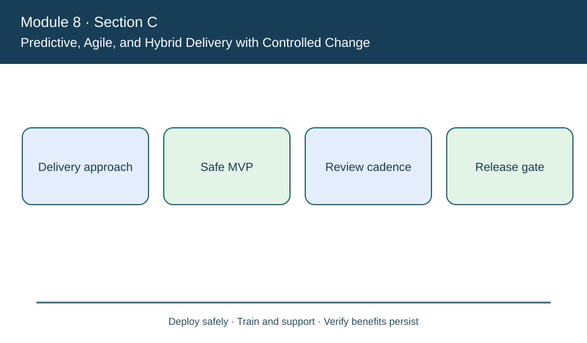
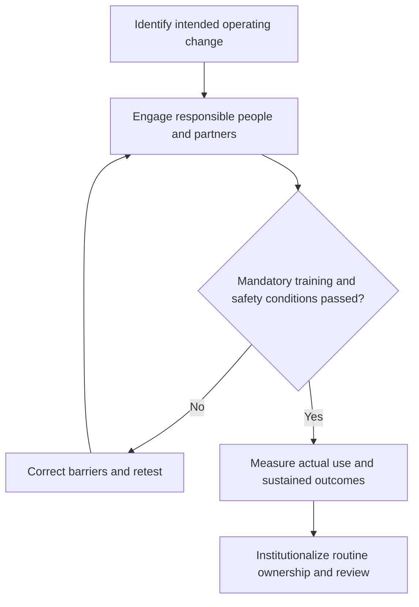

# 15. Predictive, Agile, and Hybrid Delivery with Controlled Change

## Learning objectives

Distinguish the change or maintenance approach from the actual operating outcome, identify the people and evidence required, and maintain qualified decisions beyond technology installation.

## Concept in plain English

Projects may use **predictive** delivery, agile approaches or a deliberately selected hybrid. The manual distinguishes planning and baseline controls from iterative approaches that release a minimum viable product (MVP) and add capabilities based on feedback. The choice should follow what can be learned incrementally, what dependencies are fixed and which quality or regulatory gates must be tested before use.

A predictive approach can be useful where physical installation, permits, equipment qualification and dependent construction impose a stable sequence. Agile delivery can fit evolving information products when users can review small increments and the team can safely deploy tested improvements. A warehouse system may need a hybrid: baseline physical safety requirements and integration architecture are fixed early, while dashboards and less critical exception workflows evolve over controlled releases.

Iterative delivery is not a waiver of documentation or customer acceptance. Every release must have defined scope, data ownership, automated and manual testing, security review and an accountable decision about whether the release is safe. A product backlog should distinguish desired features from mandatory controls. A minimum viable product is the smallest useful **approved** operating capability, not the cheapest incomplete system that bypasses essential requirements.

The course describes short communication cycles, prioritized work and progressive refinement. These practices can expose misunderstandings earlier, but constant changes without resource controls create an unstable delivery plan. A change request that affects product quality, training or partner interface obligations must be assessed across the connected supply chain before approval.

AlderGate chooses an iterative release sequence for customer order visibility while treating quarantined-stock release logic as a separately controlled qualification. The team measures whether each feature improves actual response rather than counting user stories completed. When an extra feature threatens the contracted go-live, the product owner prioritizes business value and explicit scope instead of quietly extending the baseline.

**2026 CSCP source:** CSCP Module 8 pp. 279–282. The fictional examples, graphics, data and assessment items are independent.

## Why it matters

A suitable delivery method reduces uncertainty while preserving quality and stakeholder trust. Choosing agile by fashion or predictive by habit can hide the actual dependency and approval conditions.

## Decision model and workflow

### Evidence retained through the workflow

| Decision/control component | Review evidence |
| --- | --- |
| Delivery approach | Baseline, user or asset scope, accountable owner and tested disposition |
| Safe MVP | Baseline, user or asset scope, accountable owner and tested disposition |
| Review cadence | Baseline, user or asset scope, accountable owner and tested disposition |
| Release gate | Baseline, user or asset scope, accountable owner and tested disposition |

## Practical process flow

## Realistic example — AlderGate Motion Products

AlderGate plans an initial safe shipment exception display, followed by carrier ETA integration, and finally qualified automated recovery suggestions. Automated release remains disabled until critical authorization tests pass.

## Applied decision artifact or worked calculation

[Directly linked fictional dataset](../../assets/data/module-8/section-c/iteration-readiness.csv)

In fictional iteration 2, **10 of 12** planned features are accepted (**83.33%**), but no critical defect remains. Iteration 3 has **9 of 10** accepted (**90%**) yet **one critical issue**; its larger completion percentage cannot authorize release of the affected function.

## Decision logic

- Explain the business change with evidence of why it matters to affected stakeholders.
- Identify who can approve a change, who must learn it and who will own it afterward.
- Use qualifications, safety, privacy and customer protections as independent gates.
- Distinguish awareness, training, actual adoption and realized results.
- Retain a practical monitoring and correction method after special project support ends.

## Trade-offs

| Management tension | Implication |
| --- | --- |
| Quick release versus readiness | A release that bypasses critical controls transfers risk to users |
| Central change program versus local context | Partners need adaptation without breaking the shared business outcome |
| Short project funding versus sustained benefits | Maintenance and operational management require resources beyond deployment |

## Commonly confused with

Completion of training, deployment of a feature and proof of sustained business adoption are different events. A percentage of tasks completed cannot establish that an unsafe condition is acceptable.

## Common mistakes

- Treating resistance as irrational instead of investigating the cause.
- Assuming a one-time project announcement creates lasting behavior.
- Misstating a modeled scenario as verified production evidence.
- Forgetting to budget ongoing support or to update operating policies.

## Original knowledge check

**Question.** A release has 90% features accepted but one critical uncorrected authorization defect. What does agile delivery permit?

A. Releasing immediately due to high feature completion

B. Approving the release if the product owner is enthusiastic

C. Treating the issue as an optional story with no safety impact

D. Holding the affected functionality until the critical test is passed

Answer and rationale

### Correct answer

**D. Holding the affected functionality until the critical test is passed**

### Why it is correct

Iterative practices do not remove mandatory security or qualification acceptance.

### Why the other answers are wrong

- **A.** Feature percentage does not override a release gate.
- **B.** Sponsor enthusiasm is not test evidence.
- **C.** Critical access failures are not optional improvements.

## Practitioner perspective

A system architect and business process owner should agree on durable exception handling, documented user decisions, operational training and funded maintenance. A project is not a substitute for routine controls and measurable support performance.

## Related concepts

- [Previous topic](./14-wbs-schedule-cost-baselines-and-change-control.md)
- [Module 6 relationship management](../../06-supply-chain-relationships/README.md)
- [Module 7 risk and continuity](../../07-supply-chain-risk/README.md)

---

[Section C overview](./README.md) · [Previous topic](./14-wbs-schedule-cost-baselines-and-change-control.md)
