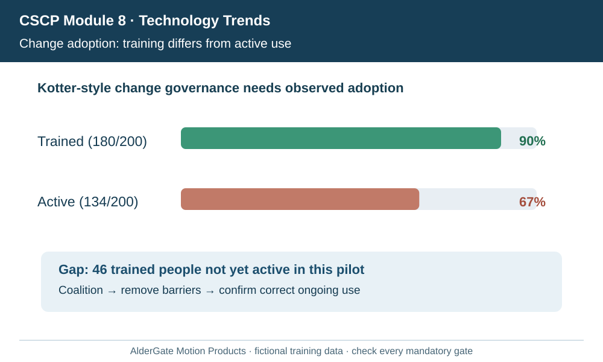
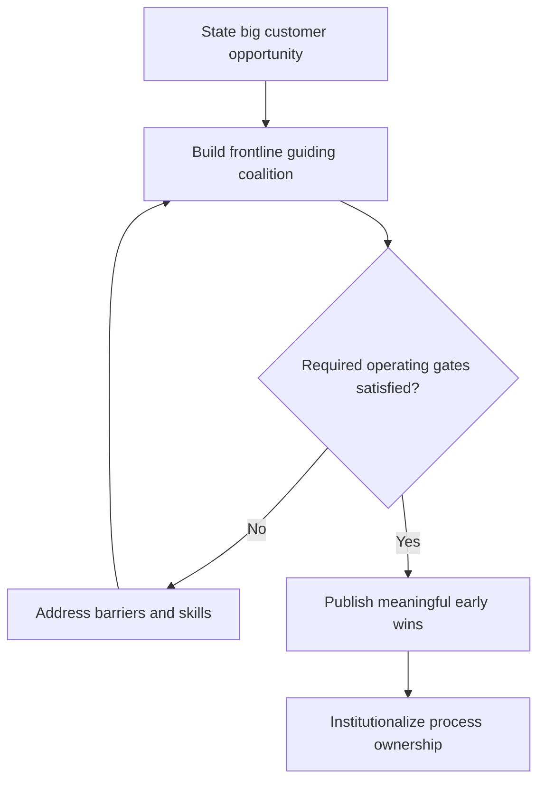

# 16. Change Management: Urgency, Coalitions, and Kotter's Change Model

## Learning objectives

Explain the decision and controls specific to **change management kotter urgency and coalitions**, recognize its human and technical dependencies, and provide evidence that outcomes persist after implementation.

## Concept in plain English

A technology installation can succeed while the intended organizational change fails. The CSCP source emphasizes that people and supply-chain partners may resist changes to familiar work, roles, authority and information. **Change management** therefore prepares the organization, builds commitment, executes changes and establishes new routines after project teams leave. It is not limited to an email announcing the selected software.

The manual discusses **Kotter's approach**, including identifying a compelling opportunity and urgency, forming a guiding coalition, communicating a vision, creating volunteer support, removing obstacles, demonstrating wins and institutionalizing new behaviors. A useful interpretation is to create broad participation while senior leadership maintains formal accountability. A coalition should include credible frontline staff and relevant partners, not only executives who signed the budget.

Change requires more than fear or pressure. Users need to understand why the new method matters to customers and their own work, what training and tools they will receive and how genuine concerns can be raised. Partner firms also need resources and incentives for new event definitions or fulfillment practices. Declaring resistance irrational is a poor substitute for identifying job safety, workload, knowledge or contract issues.

The change road map should link milestones, communications, skill development and outcome measures. An early win should be real and representative: for example, fewer unresolved priority exceptions at a pilot warehouse, not simply more logins. A win that depends on extra temporary support should not be reported as a sustainable process result without disclosure.

AlderGate introduces a cross-partner visibility workflow. Warehouse supervisors fear that automated metrics will be used to punish workers for supplier delays. The coalition sets fair exception definitions, protects reporting, offers practical training and communicates which decisions remain human-owned. Adoption is measured against actual customer outcomes rather than mandatory attendance alone.

**2026 CSCP source:** CSCP Module 8 pp. 282–290. The fictional examples, graphics, data and assessment items are independent.

## Why it matters

The new system changes how AlderGate employees and partners perceive authority and performance. Kotter's change themes emphasize urgency, coalitions and meaningful wins; a launch event alone cannot create credible long-term participation.

## Decision model and workflow

### Evidence retained through the workflow

| Decision/control component | Review evidence |
| --- | --- |
| Compelling purpose | Baseline, user or asset scope, accountable owner and tested disposition |
| Guiding coalition | Baseline, user or asset scope, accountable owner and tested disposition |
| Barrier removal | Baseline, user or asset scope, accountable owner and tested disposition |
| Institutionalization | Baseline, user or asset scope, accountable owner and tested disposition |

## Practical process flow

## Realistic example — AlderGate Motion Products

AlderGate pilots a new exception workflow with warehouse and supplier champions. Leadership sets a clear service objective and responds to frontline concerns about false alerts before expanding the system.

## Applied decision artifact or worked calculation

[Directly linked fictional dataset](../../assets/data/module-8/section-c/change-coalition.csv)

The fictional pilot has **180 trained of 200 affected people = 90% training coverage** but only **134 active users = 67% active adoption**. The gap demonstrates why learning attendance and sustained behavior are distinct measures. Neither number alone proves better customer service.

## Decision logic

- Explain the reason for change in customer and worker terms.
- Recruit credible operational and partner change agents.
- Remove data access and incentive barriers before expansion.
- Treat measurable sustained wins as evidence of adoption.

## Trade-offs

| Management tension | Implication |
| --- | --- |
| Quick release versus readiness | A release that bypasses critical controls transfers risk to users |
| Central change program versus local context | Partners need adaptation without breaking the shared business outcome |
| Short project funding versus sustained benefits | Maintenance and operational management require resources beyond deployment |

## Commonly confused with

Kotter's change leadership ideas address human and organizational momentum; they do not replace a project plan or mandated worker protections. Communication attendance is not effective process adoption, and a temporary pilot team cannot substitute for permanent roles and KPIs.

## Common mistakes

- Announcing change without explaining implications for workers.
- Treating reported concerns as resistance to suppress.
- Presenting training coverage as proof of customer improvement.

## Original knowledge check

**Question.** What is the clearest sign that change leadership has produced sustained adoption?

A. More installed software licenses

B. Regular verified use of new processes with improved customer outcomes and owned controls

C. A one-time executive launch announcement

D. A training attendance target without evidence of use

Answer and rationale

### Correct answer

**B. Regular verified use of new processes with improved customer outcomes and owned controls**

### Why it is correct

Change success requires actual new operating behavior sustained over time and linked to outcomes.

### Why the other answers are wrong

- **A.** Licenses do not prove participation or value.
- **C.** A launch announcement is not institutionalized behavior.
- **D.** Training coverage alone is not adoption.

## Practitioner perspective

Change leaders should partner with supervisors and supplier representatives to correct actual workflow barriers. Embed coaching, honest feedback, new measures and escalation routes into routine operations.

## Related concepts

- [Previous topic](./15-predictive-agile-delivery-and-integrated-change-control.md)
- [Module 6 relationship management](../../06-supply-chain-relationships/README.md)
- [Module 7 risk and continuity](../../07-supply-chain-risk/README.md)

---

[Section C overview](./README.md) · [Previous topic](./15-predictive-agile-delivery-and-integrated-change-control.md)
