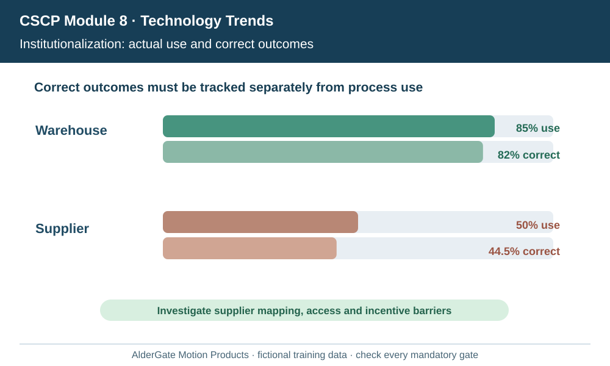
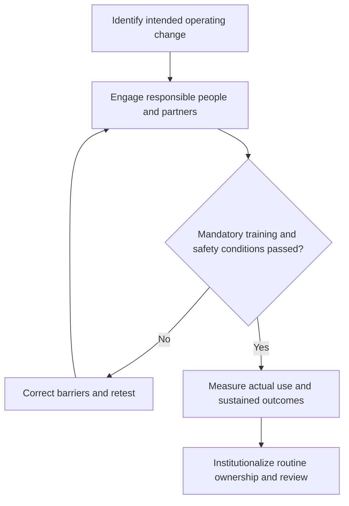

# 17. Partner Adoption, Skills, Resistance, and Institutionalization

## Learning objectives

Distinguish the change or maintenance approach from the actual operating outcome, identify the people and evidence required, and maintain qualified decisions beyond technology installation.

## Concept in plain English

Supply-chain transformation spans functions and independent companies. The source stresses preparation, execution, communication, skills, stakeholder participation, leadership and continued monitoring after a project ends. **Institutionalization** occurs when the new method becomes the actual governed way of operating through policies, metrics, job roles, budgets and routine management, rather than remaining an exceptional project pilot.

Resistance deserves diagnosis. A warehouse user may fear reduced work security; a supplier may lack API capability; a supervisor may be rewarded for local output instead of end-to-end customer service. These causes require different responses. Training, process redesign, access permission, partner funding and changed performance measures can close gaps that a generic motivation campaign cannot.

Buy-in increases when people can participate in defining the future state. Users who help test event codes and correct poor screen flow often develop more accurate procedures than a project team working alone. The implementation plan should include multiple stakeholder groups, appropriate communication languages or channels, and safe routes for escalating real problems. A provider that cannot participate should be addressed through an agreed transition plan, not silently counted as adopting the standard.

Measures must distinguish **attendance**, **capability**, **adoption** and **business outcomes**. A trainee can attend every session but fail a scenario-based test. A user who passed training may return to spreadsheets because system data is unreliable. A high login count can reflect rework rather than successful fulfillment. Organizations should observe exception quality, service promises, error rates and the persistence of improvements after extra project support is withdrawn.

AlderGate's pilot reaches 90% training coverage but much lower sustained use. The team interviews partners about the remaining barriers, funds needed interfaces, adjusts incentives and tracks whether confirmed customer promises are handled with the new workflow. The change is considered institutionalized only when process owners, helpdesk and management routines sustain it.

**2026 CSCP source:** CSCP Module 8 pp. 290–303. The fictional examples, graphics, data and assessment items are independent.

## Why it matters

Many transformation programs deliver tools without the skills, incentives and partner agreements needed to use them. Durable adoption requires process ownership and corrected barriers rather than celebrating a training percentage.

## Decision model and workflow

### Evidence retained through the workflow

| Decision/control component | Review evidence |
| --- | --- |
| Stakeholder concerns | Baseline, user or asset scope, accountable owner and tested disposition |
| Skills and access | Baseline, user or asset scope, accountable owner and tested disposition |
| Actual process use | Baseline, user or asset scope, accountable owner and tested disposition |
| Ongoing incentives | Baseline, user or asset scope, accountable owner and tested disposition |

## Practical process flow

## Realistic example — AlderGate Motion Products

One AlderGate supplier continues submitting status updates by email because its internal codes cannot be mapped to the new event feed. The team adds a controlled translation rule and support channel, then verifies the supplier's actual event quality before calling it adopted.

## Applied decision artifact or worked calculation

[Directly linked fictional dataset](../../assets/data/module-8/section-c/adoption-outcomes.csv)

The warehouse records **850/1,000 = 85% process adoption** and **820/1,000 = 82% verified correct outcomes** within the eligible population. The supplier records **200/400 = 50% adoption** and **178/400 = 44.5% correct outcomes**. Adoption and outcomes are distinct; aggregated reporting must preserve these denominators.

## Decision logic

- Explain the business change with evidence of why it matters to affected stakeholders.
- Identify who can approve a change, who must learn it and who will own it afterward.
- Use qualifications, safety, privacy and customer protections as independent gates.
- Distinguish awareness, training, actual adoption and realized results.
- Retain a practical monitoring and correction method after special project support ends.

## Trade-offs

| Management tension | Implication |
| --- | --- |
| Quick release versus readiness | A release that bypasses critical controls transfers risk to users |
| Central change program versus local context | Partners need adaptation without breaking the shared business outcome |
| Short project funding versus sustained benefits | Maintenance and operational management require resources beyond deployment |

## Commonly confused with

Completion of training, deployment of a feature and proof of sustained business adoption are different events. A percentage of tasks completed cannot establish that an unsafe condition is acceptable.

## Common mistakes

- Treating resistance as irrational instead of investigating the cause.
- Assuming a one-time project announcement creates lasting behavior.
- Misstating a modeled scenario as verified production evidence.
- Forgetting to budget ongoing support or to update operating policies.

## Original knowledge check

**Question.** A supplier has completed all training but still uses the old email workflow. What should the program do?

A. Diagnose operational barriers and provide a verified path to the new process

B. Assume the supplier is fully adopted because attendance is complete

C. Delete its legacy communication without continuity planning

D. Increase the number of dashboards without checking why the interface fails

Answer and rationale

### Correct answer

**A. Diagnose operational barriers and provide a verified path to the new process**

### Why it is correct

Sustained use depends on working data, roles, interfaces and practical incentives, not only attendance.

### Why the other answers are wrong

- **B.** Attendance does not demonstrate correct execution.
- **C.** Removing fallback without readiness can disrupt supply.
- **D.** More dashboards do not resolve supplier mapping or skills gaps.

## Practitioner perspective

A system architect and business process owner should agree on durable exception handling, documented user decisions, operational training and funded maintenance. A project is not a substitute for routine controls and measurable support performance.

## Related concepts

- [Previous topic](./16-change-management-kotter-urgency-and-coalitions.md)
- [Module 6 relationship management](../../06-supply-chain-relationships/README.md)
- [Module 7 risk and continuity](../../07-supply-chain-risk/README.md)

---

[Section C overview](./README.md) · [Previous topic](./16-change-management-kotter-urgency-and-coalitions.md)
