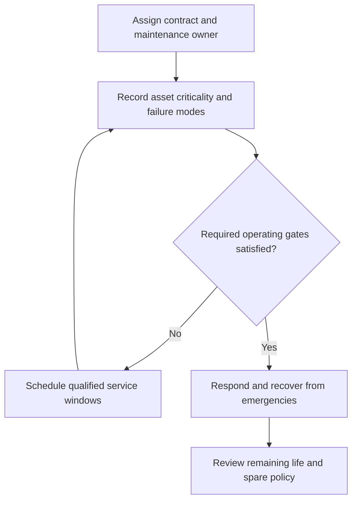

# 18. Technology Maintenance, Support, and Lifecycle Renewal

## Learning objectives

Explain the decision and controls specific to **technology maintenance support and lifecycle renewal**, recognize its human and technical dependencies, and provide evidence that outcomes persist after implementation.

## Concept in plain English

The CSCP section ends by emphasizing that technology must be **maintained** after selection and implementation. A leased SaaS system may have vendor-managed software upgrades, while local equipment and custom integrations need explicit internal or contracted maintenance owners. The division of responsibilities must be written down rather than inferred from the commercial arrangement.

A maintenance policy defines inspection frequency, configuration control, approved changes, spare parts, emergency response, security patching, backup/recovery and scheduled downtime. The details depend on the technology's criticality and age. A factory bottleneck has different operational consequences from an unused reporting screen, and a safety-related sensor may need stricter calibration and failure handling than a convenience dashboard.

Predictive analytics can help estimate deterioration and maintenance needs, but a prediction is only one source of evidence. Qualified technicians need to confirm condition, check safe working arrangements and issue approved maintenance work. Aging equipment may exhibit changing failure rates, so spare inventory and replacement timing should be revised from actual history. Working with Finance, owners should document changes in expected useful life and capital or expense treatment.

Operational support requires an incident process for emergencies. A system that meets its average service target may still fail disastrously during a peak demand period. Recovery objectives, vendor response commitments and the authority to revert configuration must be tested. Maintenance schedules should minimize conflict with production and may be coordinated with changeovers or off-shift windows, subject to worker safety and labor requirements.

AlderGate's connected press-monitoring system enters routine ownership after pilot acceptance. The maintenance lead holds a current asset list, approved thresholds, spare sensors, calibration plans and vendor support escalation. A recurring review compares breakdown hours and restoration performance, then recommends upgrade or retirement when value declines.

**2026 CSCP source:** CSCP Module 8 pp. 303–305. The fictional examples, graphics, data and assessment items are independent.

## Why it matters

Technology value decays without timely maintenance, clear vendor boundaries and spare/incident support. AlderGate's planned servicing uses more scheduled hours but aims to avoid disruptive unplanned failures and protect critical manufacturing capacity.

## Decision model and workflow

### Evidence retained through the workflow

| Decision/control component | Review evidence |
| --- | --- |
| Maintenance owner | Baseline, user or asset scope, accountable owner and tested disposition |
| Planned schedule | Baseline, user or asset scope, accountable owner and tested disposition |
| Emergency restore | Baseline, user or asset scope, accountable owner and tested disposition |
| Useful-life review | Baseline, user or asset scope, accountable owner and tested disposition |

## Practical process flow

## Realistic example — AlderGate Motion Products

AlderGate schedules sensor recalibration during planned equipment changeovers and keeps replacement sensors for a critical finishing press. Service response rules prioritize the bottleneck and forbid automatic safety overrides from a predictive model.

## Applied decision artifact or worked calculation

[Directly linked fictional dataset](../../assets/data/module-8/section-c/technology-maintenance.csv)

The fictional maintenance program increases planned work from **40 to 55 hours** but reduces unplanned downtime from **95 to 48 hours** over the same 2,000 operating-hour scope. Combined planned-plus-unplanned maintenance/downtime changes from **135 to 103 hours**, a nominal **32-hour reduction** under these assumptions. It is not automatically a causal benefit or full economic value without workload and cost controls.

## Decision logic

- Distinguish vendor hosted support from local device responsibility.
- Use safety based prioritization and permitted configuration.
- Coordinate downtime with changeovers and material plans.
- Update useful life and costs from verified maintenance records.

## Trade-offs

| Management tension | Implication |
| --- | --- |
| Quick release versus readiness | A release that bypasses critical controls transfers risk to users |
| Central change program versus local context | Partners need adaptation without breaking the shared business outcome |
| Short project funding versus sustained benefits | Maintenance and operational management require resources beyond deployment |

## Commonly confused with

A software subscription does not automatically provide every equipment repair. Predictive maintenance forecasts possible problems and does not replace physical qualification. Planned maintenance time and unplanned downtime need separate measurement before assessing availability or cost.

## Common mistakes

- Assuming a cloud vendor maintains every local scanner or robot.
- Automating critical machine responses from unvalidated readings.
- Omitting emergency response and repair spare arrangements.

## Original knowledge check

**Question.** What should happen when a technology initiative moves into ongoing operations?

A. Terminate all technology-related funding immediately

B. Assume the vendor maintains all equipment regardless of contract

C. Stop measuring downtime after the project review

D. Assign maintenance, recovery, configuration and lifecycle owners with operating metrics

Answer and rationale

### Correct answer

**D. Assign maintenance, recovery, configuration and lifecycle owners with operating metrics**

### Why it is correct

Long-term support needs documented ownership and sustained controls, whether provided internally or contracted.

### Why the other answers are wrong

- **A.** Ongoing maintenance requires resources.
- **B.** The service boundary depends on the actual contract and system.
- **C.** Monitoring remains needed after project handover.

## Practitioner perspective

Establish equipment ownership, approved patch and calibration calendars, service escalation tiers and operational recovery drills. Maintenance evidence should inform planning and the asset's lifecycle financial assumptions.

## Related concepts

- [Previous topic](./17-partner-adoption-resistance-skills-and-institutionalization.md)
- [Module 6 relationship management](../../06-supply-chain-relationships/README.md)
- [Module 7 risk and continuity](../../07-supply-chain-risk/README.md)

---

[Section C overview](./README.md) · [Previous topic](./17-partner-adoption-resistance-skills-and-institutionalization.md)
