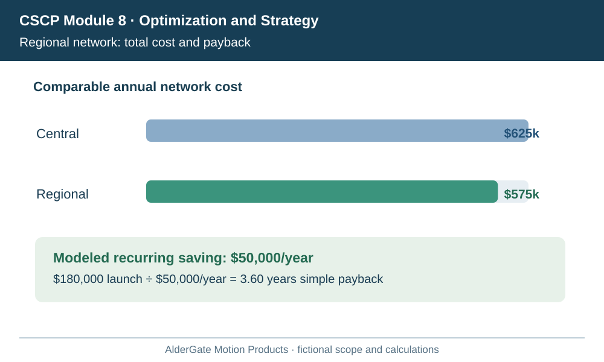
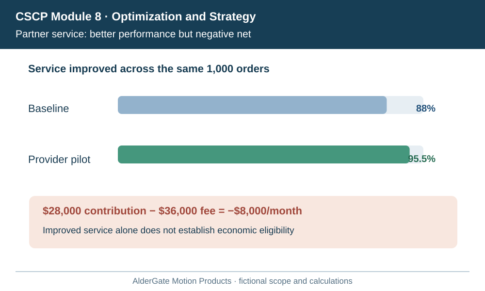
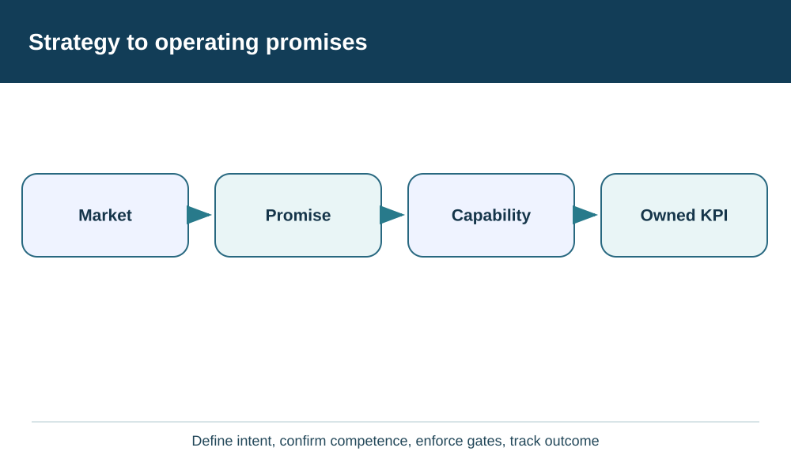
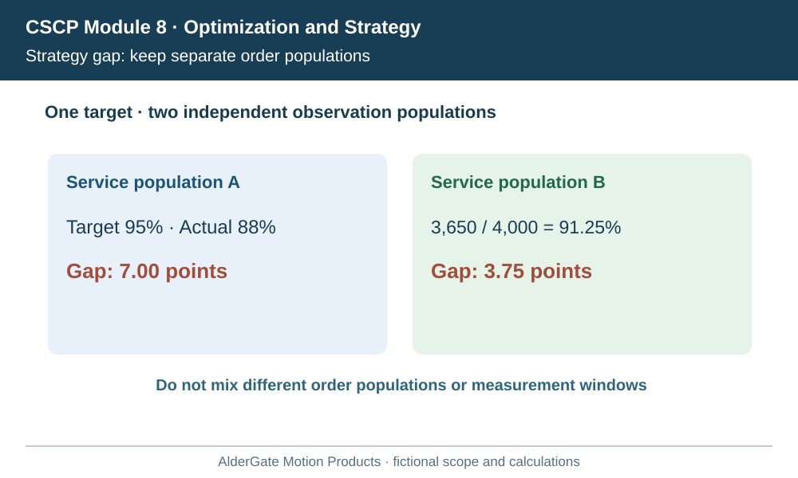
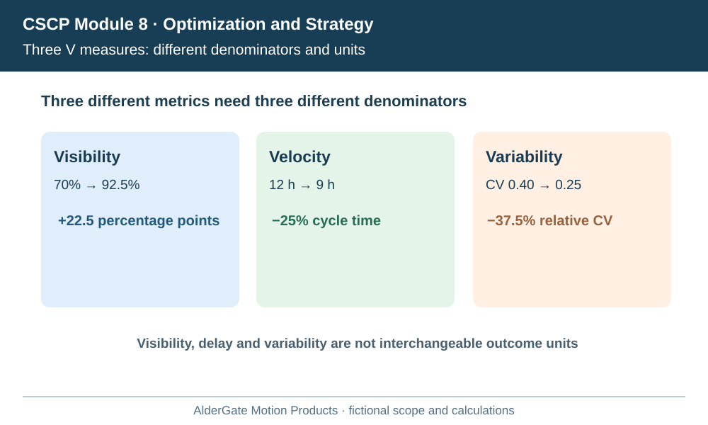
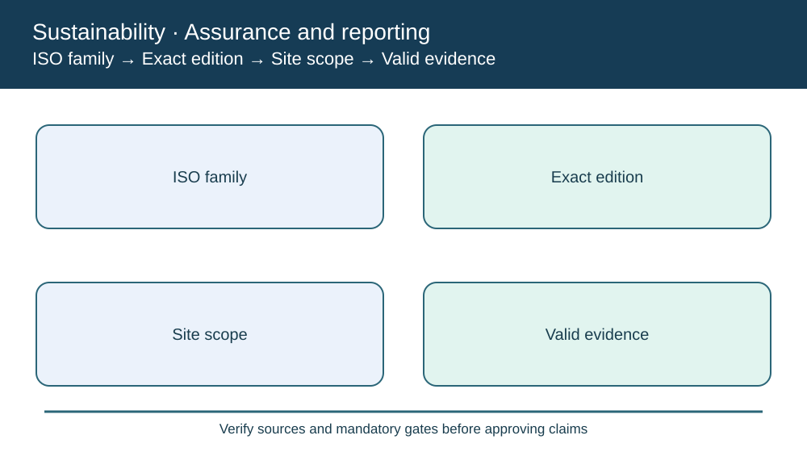
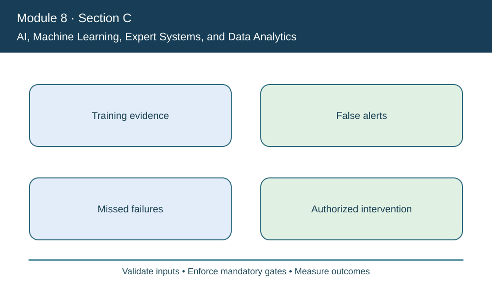
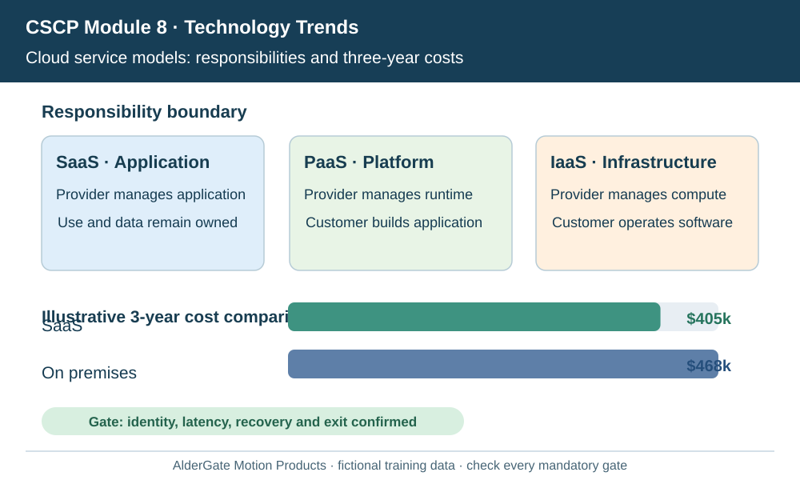
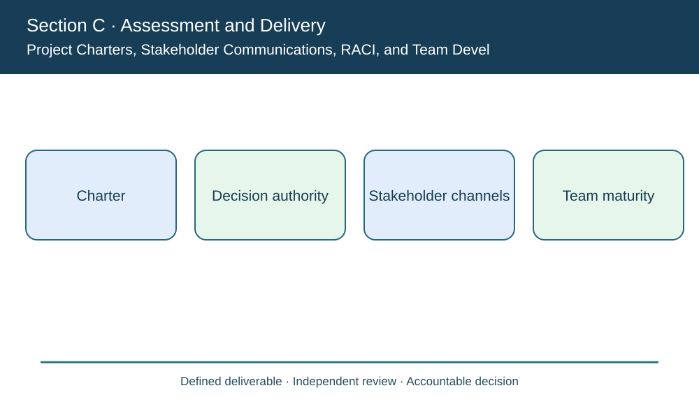
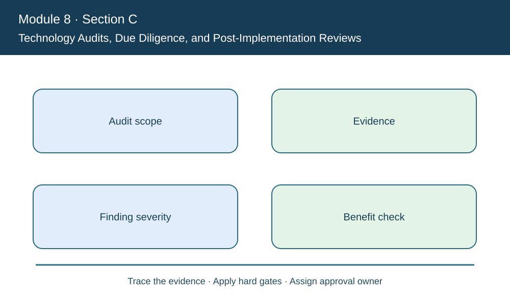

# Module 8 — Actual GitHub SVG Visual Review Gallery

> **Review candidate only.** This gallery links directly to the original SVG files committed in draft PR #17. It places each same image at a wide and a narrow display width for a convenient **GitHub-rendered spot-check**. The gallery is a human inspection aid; its existence is **not** evidence a reviewer has inspected every rasterized page or signed the visual/editorial release gate.

**Owner visual review — 2026-10-22:** The owner reported inspecting all **45** diagrams, finding no issues, and requesting no corrections. This is recorded as a self-reported owner sign-off, not independent reviewer certification or evidence of an exact browser viewport. The owner explicitly prohibited merging at this stage.

**Visual checklist:** At both widths confirm that every label is readable, text does not collide with bars or legends, decision steps remain meaningful, source example units and denominators are unambiguous, and the visual illustrates the lesson instead of repeating a generic card layout. Also open a linked lesson to inspect Mermaid workflows, questions and table rendering.

The independent source-level [SVG audit script](./scripts/validate_module8_visuals.py) checks all 45 diagrams for accessible title/description, expected quantitative labels, diversity of layouts, basic text bounds and unsafe embedded content. It is a **static heuristic**, not a substitute for visual inspection or a rasterized preview.

## Section A — Strategy and Optimization (12 originals)

<table>
<thead><tr><th>Diagram / original</th><th>Full-width preview (720 px)</th><th>Narrow preview (320 px)</th></tr></thead>
<tbody>
<tr><td><a href="./assets/diagrams/module-8/section-a/business-plan-competency-bridge.svg">business plan competency bridge</a></td><td></td><td></td></tr>
<tr><td><a href="./assets/diagrams/module-8/section-a/competitive-positioning-service-cost-matrix.svg">competitive positioning service cost matrix</a></td><td></td><td></td></tr>
<tr><td><a href="./assets/diagrams/module-8/section-a/discounted-cash-flow-payback.svg">discounted cash flow payback</a></td><td></td><td></td></tr>
<tr><td><a href="./assets/diagrams/module-8/section-a/linear-program-product-mix.svg">linear program product mix</a></td><td></td><td></td></tr>
<tr><td><a href="./assets/diagrams/module-8/section-a/network-alternative-feasibility.svg">network alternative feasibility</a></td><td></td><td></td></tr>
<tr><td><a href="./assets/diagrams/module-8/section-a/network-location-cost-stack.svg">network location cost stack</a></td><td></td><td></td></tr>
<tr><td><a href="./assets/diagrams/module-8/section-a/segment-uncertainty-policy-map.svg">segment uncertainty policy map</a></td><td></td><td></td></tr>
<tr><td><a href="./assets/diagrams/module-8/section-a/service-capability-partner-gate.svg">service capability partner gate</a></td><td></td><td></td></tr>
<tr><td><a href="./assets/diagrams/module-8/section-a/stakeholder-value-and-duty-gates.svg">stakeholder value and duty gates</a></td><td></td><td></td></tr>
<tr><td><a href="./assets/diagrams/module-8/section-a/strategy-alignment-decision-chain.svg">strategy alignment decision chain</a></td><td></td><td></td></tr>
<tr><td><a href="./assets/diagrams/module-8/section-a/strategy-gap-governance-loop.svg">strategy gap governance loop</a></td><td></td><td></td></tr>
<tr><td><a href="./assets/diagrams/module-8/section-a/visibility-velocity-variability-controls.svg">visibility velocity variability controls</a></td><td></td><td></td></tr>
</tbody>
</table>

## Section B — Sustainability (12 originals)

<table>
<thead><tr><th>Diagram / original</th><th>Full-width preview (720 px)</th><th>Narrow preview (320 px)</th></tr></thead>
<tbody>
<tr><td><a href="./assets/diagrams/module-8/section-b/conflict-minerals-and-responsible-material-due-diligence.svg">conflict minerals and responsible material due diligence</a></td><td></td><td></td></tr>
<tr><td><a href="./assets/diagrams/module-8/section-b/corporate-social-responsibility-labor-and-community.svg">corporate social responsibility labor and community</a></td><td></td><td></td></tr>
<tr><td><a href="./assets/diagrams/module-8/section-b/environmental-footprint-energy-packaging-reverse-flows.svg">environmental footprint energy packaging reverse flows</a></td><td></td><td></td></tr>
<tr><td><a href="./assets/diagrams/module-8/section-b/gri-standards-and-impact-materiality.svg">gri standards and impact materiality</a></td><td></td><td></td></tr>
<tr><td><a href="./assets/diagrams/module-8/section-b/iso-26000-sa8000-ansi-z10-and-assurance.svg">iso 26000 sa8000 ansi z10 and assurance</a></td><td></td><td></td></tr>
<tr><td><a href="./assets/diagrams/module-8/section-b/iso-quality-and-environmental-management.svg">iso quality and environmental management</a></td><td></td><td></td></tr>
<tr><td><a href="./assets/diagrams/module-8/section-b/micro-macro-economics-and-time-horizon.svg">micro macro economics and time horizon</a></td><td></td><td></td></tr>
<tr><td><a href="./assets/diagrams/module-8/section-b/oecd-guidelines-and-impact-due-diligence.svg">oecd guidelines and impact due diligence</a></td><td></td><td></td></tr>
<tr><td><a href="./assets/diagrams/module-8/section-b/regulatory-voluntary-programs-and-compliance-gates.svg">regulatory voluntary programs and compliance gates</a></td><td></td><td></td></tr>
<tr><td><a href="./assets/diagrams/module-8/section-b/sustainability-kpi-evidence-and-greenwashing-controls.svg">sustainability kpi evidence and greenwashing controls</a></td><td></td><td></td></tr>
<tr><td><a href="./assets/diagrams/module-8/section-b/sustainable-supply-chains-and-triple-bottom-line.svg">sustainable supply chains and triple bottom line</a></td><td></td><td></td></tr>
<tr><td><a href="./assets/diagrams/module-8/section-b/un-global-compact-ten-principles.svg">un global compact ten principles</a></td><td></td><td></td></tr>
</tbody>
</table>

## Section C — Technology Trends (18 originals)

<table>
<thead><tr><th>Diagram / original</th><th>Full-width preview (720 px)</th><th>Narrow preview (320 px)</th></tr></thead>
<tbody>
<tr><td><a href="./assets/diagrams/module-8/section-c/additive-ar-wearables-robots-drones-quantum.svg">additive ar wearables robots drones quantum</a></td><td></td><td></td></tr>
<tr><td><a href="./assets/diagrams/module-8/section-c/ai-machine-learning-and-data-analytics.svg">ai machine learning and data analytics</a></td><td></td><td></td></tr>
<tr><td><a href="./assets/diagrams/module-8/section-c/blockchain-provenance-and-smart-contract-gates.svg">blockchain provenance and smart contract gates</a></td><td></td><td></td></tr>
<tr><td><a href="./assets/diagrams/module-8/section-c/change-management-kotter-urgency-and-coalitions.svg">change management kotter urgency and coalitions</a></td><td></td><td></td></tr>
<tr><td><a href="./assets/diagrams/module-8/section-c/cloud-service-models-and-operating-tradeoffs.svg">cloud service models and operating tradeoffs</a></td><td></td><td></td></tr>
<tr><td><a href="./assets/diagrams/module-8/section-c/implementation-integration-testing-and-cutover.svg">implementation integration testing and cutover</a></td><td></td><td></td></tr>
<tr><td><a href="./assets/diagrams/module-8/section-c/intelligent-iot-asset-management-digital-twins.svg">intelligent iot asset management digital twins</a></td><td></td><td></td></tr>
<tr><td><a href="./assets/diagrams/module-8/section-c/partner-adoption-resistance-skills-and-institutionalization.svg">partner adoption resistance skills and institutionalization</a></td><td></td><td></td></tr>
<tr><td><a href="./assets/diagrams/module-8/section-c/predictive-agile-delivery-and-integrated-change-control.svg">predictive agile delivery and integrated change control</a></td><td></td><td></td></tr>
<tr><td><a href="./assets/diagrams/module-8/section-c/project-charters-stakeholders-raci-and-team-development.svg">project charters stakeholders raci and team development</a></td><td></td><td></td></tr>
<tr><td><a href="./assets/diagrams/module-8/section-c/sensors-telematics-and-control-towers.svg">sensors telematics and control towers</a></td><td></td><td></td></tr>
<tr><td><a href="./assets/diagrams/module-8/section-c/strategic-tactical-operational-technology-requirements.svg">strategic tactical operational technology requirements</a></td><td></td><td></td></tr>
<tr><td><a href="./assets/diagrams/module-8/section-c/technology-audits-risk-and-post-implementation-review.svg">technology audits risk and post implementation review</a></td><td></td><td></td></tr>
<tr><td><a href="./assets/diagrams/module-8/section-c/technology-gap-analysis-data-process-and-skills.svg">technology gap analysis data process and skills</a></td><td></td><td></td></tr>
<tr><td><a href="./assets/diagrams/module-8/section-c/technology-maintenance-support-and-lifecycle-renewal.svg">technology maintenance support and lifecycle renewal</a></td><td></td><td></td></tr>
<tr><td><a href="./assets/diagrams/module-8/section-c/technology-roadmaps-and-sequencing.svg">technology roadmaps and sequencing</a></td><td></td><td></td></tr>
<tr><td><a href="./assets/diagrams/module-8/section-c/technology-selection-feasibility-tco-and-value.svg">technology selection feasibility tco and value</a></td><td></td><td></td></tr>
<tr><td><a href="./assets/diagrams/module-8/section-c/wbs-schedule-cost-baselines-and-change-control.svg">wbs schedule cost baselines and change control</a></td><td></td><td></td></tr>
</tbody>
</table>

## Integrated AlderGate Capstone (3 originals)

<table>
<thead><tr><th>Diagram / original</th><th>Full-width preview (720 px)</th><th>Narrow preview (320 px)</th></tr></thead>
<tbody>
<tr><td><a href="./assets/diagrams/module-8/capstone/aldergate-gated-program-decision.svg">aldergate gated program decision</a></td><td></td><td></td></tr>
<tr><td><a href="./assets/diagrams/module-8/capstone/aldergate-network-capacity-and-footprint.svg">aldergate network capacity and footprint</a></td><td></td><td></td></tr>
<tr><td><a href="./assets/diagrams/module-8/capstone/aldergate-npv-adoption-sensitivity.svg">aldergate npv adoption sensitivity</a></td><td></td><td></td></tr>
</tbody>
</table>

## Recommended release-review sequence

1. Inspect this gallery in GitHub at a wide desktop window and a narrow browser/mobile window; text legibility at 320 px may require zooming for dense quantitative charts.
2. Open [Section A](./08-optimization-sustainability-technology/section-a-optimizing-supply-chain-strategy-and-tactics/README.md), [Section B](./08-optimization-sustainability-technology/section-b-sustainability/README.md), and [Section C](./08-optimization-sustainability-technology/section-c-technology-trends/README.md) lessons and check how source Markdown, Mermaid diagrams and SVGs actually render.
3. Inspect the [integrated assignment](./08-optimization-sustainability-technology/capstone/README.md) and [worked solution](./08-optimization-sustainability-technology/capstone/solution-guide.md) at both widths.
4. Record any clipped label, illegible plot, arithmetic mismatch, semantic flaw, repetitive or suspiciously copied prose, or broken external source. Close findings and rerun CI before release.
5. Obtain explicit owner approval before changing PR #17 from draft to mergeable and updating the published release metadata.

**Status:** Gallery prepared. **Human visual and independent originality sign-off remains open.** The existing Modules 1–7 content on `main` is not modified.
